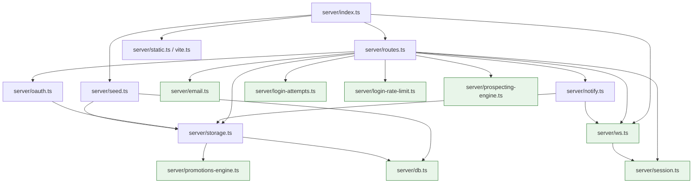

# Server Architecture Refactoring Analysis

**Status:** Audit only. No source files were modified, moved, or renamed to produce this
document. `server/routes.ts` and `server/storage.ts` are untouched.

**Method:** Every number and claim below was obtained by directly reading and
programmatically scanning the actual files in this repository (`server/routes.ts`,
`server/storage.ts`, and every other file under `server/`), not by assumption. Where
something could not be verified with confidence, it is explicitly marked **Unknown /
needs manual verification** rather than guessed.

---

## 1. Current Architecture

### 1.1 `server/` folder — actual contents

| File | Lines | Role (verified) |
|---|---:|---|
| `routes.ts` | **10,947** | The entire HTTP API surface — one exported function, `registerRoutes(httpServer, app)`, containing ~575 `app.get/post/patch/put/delete(...)` calls plus auth middleware, rate limiters, and a few inline helpers. |
| `storage.ts` | **14,773** | The entire data-access layer — one `IStorage` interface + one `DatabaseStorage` class implementing it, instantiated once as `export const storage = new DatabaseStorage()`. |
| `db.ts` | 28 | Drizzle/`pg` Pool setup. Exports `db` and `pool`. No other local imports. |
| `session.ts` | 24 | `express-session` + `memorystore` configuration. Exports `sessionMiddleware`. Explicitly commented as "imported by both routes.ts and ws.ts". No other local imports. |
| `ws.ts` | 75 | WebSocket server. Exports `setupWebSocket`, `broadcast`, `broadcastToUsers`. Imports only `session.ts`. |
| `notify.ts` | 62 | Persistent-notification + realtime-push helper. Exports `notify`, `notifyMany`. Imports `storage.ts` and `ws.ts`. |
| `email.ts` | 354 | Nodemailer wrapper for password-reset emails. No local imports besides types. |
| `oauth.ts` | 127 | Google/Facebook passport strategies for *existing accounts only*. Imports `storage.ts`. |
| `login-attempts.ts` | 72 | In-memory per-account failed-login tracker (admin-configurable, task-48 era). No local imports. |
| `login-rate-limit.ts` | 46 | In-memory per-IP login rate limiter (admin-configurable, task-48 era). No local imports. |
| `promotions-engine.ts` | 246 | Pure cart/promotion evaluation engine. Imports only `@shared/schema` **types**. No local imports. |
| `prospecting-engine.ts` | 351 | Google Places grid-search engine for Admin Prospecting. No local imports. |
| `seed.ts` | 359 | Idempotent DB seeding, run once at startup from `index.ts` (not from `routes.ts`). Imports `db.ts` and `storage.ts`. |
| `index.ts` | 110 | Process entry point. Wires everything together (see 1.3). |
| `static.ts` / `vite.ts` | 19 / 58 | Static file serving / Vite dev middleware. No relevance to this refactor. |

### 1.2 Responsibilities of `routes.ts`

`routes.ts` is **not** a collection of independent files glued together — it is the literal
body of one function:

```ts
export async function registerRoutes(httpServer: Server, app: Express): Promise<Server> {
  // lines 80–10945 — everything lives in this one closure
}
```

Inside that single closure, before the first route is registered, it defines:

- **7 role/approval-gate middlewares**, all closures over `storage` (lines ~110–94):
  `requireAuth`, `requireAdmin`, `requireApprovedCafeOwner`,
  `requireApprovedAcademyRegistrant`, `requireApprovedSupplier`,
  `requireApprovedDeliveryCompany`, `requireDriver`.
- **3 business-logic helpers**: `hasCommercialAccess(req)`, `stripCommercialData(p)`,
  `canUpdateOrderStatus(user, order, newStatus)`.
- **2 password-policy helpers + 1 message builder**: `buildRegistrationPasswordSchema`,
  `isValidRegistrationPassword`, `registrationPasswordMessage` — used at 4 call sites
  across what will become at least 2 different domain modules (registration, password
  reset, profile password change, admin-created users).
- **5 module-level `express-rate-limit` instances**: `loginRateLimiter`,
  `registerRateLimiter`, `forgotPasswordRateLimiter`, `verifyResetCodeRateLimiter`,
  `resetPasswordRateLimiter`.
- One ambient type augmentation: `declare module "express-session" { interface
  SessionData { userId: number } }`.

Every one of the ~575 route handlers that follows is a statement inside this same
function body, so every handler already has closure access to all of the above —
**today there are zero import statements for `requireAuth`/`requireAdmin`/etc. anywhere
in the file, because none are needed.** This is the single most important structural
fact for Phase 1: splitting this file means these closures must be **hoisted out and
turned into genuinely importable, exported functions/factories** before any domain
module can be extracted, because a domain file cannot "inherit" a `const` from a
function body it is no longer textually inside of.

### 1.3 Startup sequence (`index.ts`) — order matters

```
1. new express() + createServer(app)
2. app.use(express.json()) / urlencoded()  — body/raw-body capture
3. request-logging middleware
4. setupWebSocket(httpServer)              // ws.ts — MUST run before registerRoutes
5. await registerRoutes(httpServer, app)   // routes.ts — mounts every /api/* route
6. await seedDatabase()                    // seed.ts — DB must already exist/connect
7. generic error-handling middleware
8. serveStatic(app)  OR  setupVite(httpServer, app)   // prod vs dev, must be LAST
9. httpServer.listen(port)
```

This ordering is explicitly commented in `index.ts` itself ("importantly only setup
vite ... after setting up all the other routes so the catch-all route doesn't
interfere") and must be preserved byte-for-byte regardless of how `routes.ts` is
internally reorganized — the refactor changes *what is inside* `registerRoutes`, never
*when it is called* or *what it returns*.

### 1.4 Responsibilities of `storage.ts`

```ts
export interface IStorage { /* lines 119–697 */ }
export class DatabaseStorage implements IStorage { /* lines 699–14771 */ }
export const storage = new DatabaseStorage();   // one eager singleton
```

- `IStorage` declares **362 method signatures**.
- `DatabaseStorage` implements **593 public `async` methods** — i.e. **231 methods
  exist on the class with no corresponding interface declaration at all.** This is not
  a hypothetical risk: it is the file's actual, current state, and it has been this way
  incrementally for a long time (most recently-added entity-report systems in this
  codebase — Maintenance/Barista/Print/Academy/Marketing/Supplier reports — are on the
  class but **not** in `IStorage`, with the sole exception of the Academy report
  methods, which *are* declared). Any backward-compatibility strategy must account for
  this gap explicitly (see §3.4).
- In addition to the 593 public methods, the class has **86 `private` members**
  (helpers, cached transition tables, computed-stats functions — full list in §3.1).
  Two more pure helper functions (`enrichProduct`, `computeListingOffer`) live at
  module scope between the interface and the class, not on the class at all.
- **16 call sites** use `db.transaction(async (tx) => { ... })`. At least one of them
  (verified directly, `createSupplierListingWithVariants`, lines 11672–11685) calls
  **other instance methods inside the transaction**, passing the transaction client
  through:
  ```ts
  async createSupplierListingWithVariants(data, variants) {
    return db.transaction(async (tx) => {
      const listing = await this.createSupplierListing(data, tx);
      const savedVariants = await this.saveVariants(listing.id, variants, tx);
      ...
    });
  }
  ```
  This is the concrete proof behind a repo-wide pattern: **327 occurrences** of
  `this.someOtherMethod(...)` exist inside `storage.ts` (methods calling sibling
  methods on the same instance). This single fact drives the entire strategy in §3.4 —
  a plain "cut each function into its own file and `export` it" approach would silently
  break every one of these 327 call sites unless `this` still resolves to an object
  that has *all* of them, including the ones physically written in a different file.

### 1.5 Main dependency direction between the two files

```
storage.ts  →  db.ts, promotions-engine.ts, @shared/schema, drizzle-orm   (no other server/* files)
routes.ts   →  storage.ts, ws.ts, notify.ts, email.ts, oauth.ts, login-attempts.ts,
               login-rate-limit.ts, prospecting-engine.ts, session.ts,
               @shared/schema, @shared/routes, drizzle-orm, zod, express-rate-limit
```

**Verified: no circular dependency exists between any two files in `server/` today.**
`storage.ts` is imported by `notify.ts`, `oauth.ts`, `routes.ts`, and `seed.ts` — all
one-directional; none of those four is ever imported back by `storage.ts`. `routes.ts`
is imported **only** by `index.ts`. This is a genuinely clean starting point: the
problem to solve is file *size*, not tangled cross-file coupling.

---

## 2. `routes.ts` Analysis

### 2.1 Complete route inventory

A programmatic scan matched **570 of the ~575** `app.<method>(...)` registrations (a
handful of multi-line `app.get(\n  "/path", ...)` declarations were not matched by the
single-line regex used for this inventory and are flagged **Unknown — verify
manually** rather than silently omitted; they do not change the domain picture below).
14 routes are registered via the typed `api.auth.*` / `api.products.*` / `api.orders.*`
constants from `shared/routes.ts` rather than string literals — these were resolved to
their real paths for this inventory. `shared/routes.ts` additionally defines (but
`routes.ts` never references) typed contracts for `deliveries`, `deliveryCompanyDrivers`,
`supplierDrivers`, and `barista` — these are either client-side-only typing aids or
dead code; **Unknown — not determined by this audit**, flagged for the team to decide
when touched.

Routes group cleanly by their first path segment (and, for `/api/admin/*`, by their
*second* segment) into **16 real business domains** — this was verified by actually
breaking down all 176 `/api/admin/*` routes by sub-segment, which confirmed that admin
routes for a given service (e.g. `/api/admin/maintenance/*`) are not a separate "Admin"
business concern at all — they belong to the exact same domain as their non-admin
counterpart. This is the basis for the one-module-per-domain (not
one-module-for-admin) recommendation below.

<details>
<summary><strong>Shop Catalog — 76 routes</strong> (products, packs, categories, brands, flavors, sizes, promotions, discount codes, marketplace browsing, generic favorites)</summary>

```
GET    /api/admin/catalog-suggestions
PATCH  /api/admin/catalog-suggestions/:type/:id
DELETE /api/admin/catalog-suggestions/:type/:id
PATCH  /api/admin/catalog-suggestions/:type/:id/approve
GET    /api/admin/packs
PATCH  /api/admin/packs/:id
DELETE /api/admin/packs/:id
GET    /api/admin/products
POST   /api/admin/products
PATCH  /api/admin/products/:id
DELETE /api/admin/products/:id
GET    /api/brands
POST   /api/brands
PATCH  /api/brands/:id
DELETE /api/brands/:id
PATCH  /api/brands/bulk-order
GET    /api/categories
POST   /api/categories
PATCH  /api/categories/:id
DELETE /api/categories/:id
PATCH  /api/categories/bulk-order
GET    /api/discount-codes
POST   /api/discount-codes
PUT    /api/discount-codes/:id
DELETE /api/discount-codes/:id
PATCH  /api/discount-codes/:id/status
GET    /api/discount-codes/:id/usage
GET    /api/discount-codes/stats
POST   /api/discount-codes/validate
GET    /api/favorites
POST   /api/favorites
DELETE /api/favorites/:productId
GET    /api/flavors
POST   /api/flavors
PATCH  /api/flavors/:id
DELETE /api/flavors/:id
PATCH  /api/flavors/bulk-order
GET    /api/marketplace
GET    /api/marketplace/:productId
GET    /api/marketplace/packs
GET    /api/marketplace/packs/:id
GET    /api/marketplace/products/image-data
GET    /api/marketplace/promotions
GET    /api/pack-favorites
POST   /api/pack-favorites
DELETE /api/pack-favorites/:packId
GET    /api/packs/:id
GET    /api/packs/:id/composition
GET    /api/products
POST   /api/products
GET    /api/products/:id
PUT    /api/products/:id
DELETE /api/products/:id
GET    /api/promotions
POST   /api/promotions
GET    /api/promotions/:id
PUT    /api/promotions/:id
DELETE /api/promotions/:id
POST   /api/promotions/:id/duplicate
PATCH  /api/promotions/:id/status
PATCH  /api/promotions/:id/targets
GET    /api/promotions/:id/usage
POST   /api/promotions/evaluate
GET    /api/promotions/my-categories
GET    /api/promotions/my-listings
GET    /api/promotions/stats
GET    /api/sizes
POST   /api/sizes
PATCH  /api/sizes/:id
DELETE /api/sizes/:id
PATCH  /api/sizes/bulk-order
GET    /api/subcategories
POST   /api/subcategories
PATCH  /api/subcategories/:id
DELETE /api/subcategories/:id
PATCH  /api/subcategories/bulk-order
GET    /api/sizes               (bulkUpdateSizeOrder-backed — see note in §3.1)
```

**Proposed file:** `server/routes/shop-catalog.routes.ts`
**Middleware used:** `requireAuth`, `requireAdmin`, plus the public (unauthenticated)
`hasCommercialAccess`/`stripCommercialData` pricing-visibility pair for `/marketplace*`.
**Storage calls:** the "Shop Catalog" storage bucket (§3.1) — `createProduct`,
`getMarketplaceProducts`, `createPromotion`, `validateDiscountCode`, etc.
**Shared utilities needed:** `stripCommercialData`/`hasCommercialAccess` (currently
routes.ts-local closures — must move to a shared middleware module, §4), taxonomy
bulk-order helpers shared with every other taxonomy (categories/brands/flavors/sizes
all have an identical `bulk-order` endpoint shape).
</details>

<details>
<summary><strong>Supplier & Stores — 76 routes</strong> (Supplier's own business dashboard, Shop Store pages, Admin store/supplier moderation, Supplier entity reports)</summary>

```
GET    /api/admin/stores
GET    /api/admin/stores/:id
DELETE /api/admin/stores/:id
PATCH  /api/admin/stores/:id/approve
PATCH  /api/admin/stores/:id/auto-approve
PATCH  /api/admin/stores/:id/hold
PATCH  /api/admin/stores/:id/order
PATCH  /api/admin/stores/:id/reject
PATCH  /api/admin/stores/bulk-order
GET    /api/admin/supplier-mappings
PATCH  /api/admin/supplier-mappings/:supplierId
POST   /api/admin/supplier-mappings/:supplierId/categories/:categoryId
DELETE /api/admin/supplier-mappings/:supplierId/categories/:categoryId
PATCH  /api/admin/supplier-mappings/:supplierId/categories/:categoryId/approve
PATCH  /api/admin/supplier-mappings/:supplierId/categories/:categoryId/freeze
GET    /api/admin/supplier-mappings/:supplierId/overview
GET    /api/admin/supplier-products
PATCH  /api/admin/supplier-products/:id
DELETE /api/admin/supplier-products/:id
PATCH  /api/admin/supplier-products/:id/approve
GET    /api/admin/supplier/reports
PATCH  /api/admin/supplier/reports/:id/resolve
GET    /api/store-favorites
POST   /api/store-favorites
DELETE /api/store-favorites/:storeId
GET    /api/stores
GET    /api/stores/:id
GET    /api/stores/:id/packs
GET    /api/supplier/:supplierId/promotions
POST   /api/supplier/:userId/report
GET    /api/supplier/admin-products
GET    /api/supplier/cafes
POST   /api/supplier/cafes
GET    /api/supplier/catalog-suggestions
POST   /api/supplier/catalog-suggestions
PATCH  /api/supplier/catalog-suggestions/:type/:id
DELETE /api/supplier/catalog-suggestions/:type/:id
GET    /api/supplier/categories
POST   /api/supplier/categories
DELETE /api/supplier/categories/:categoryId
PATCH  /api/supplier/categories/:categoryId/freeze
PATCH  /api/supplier/categories/order
GET    /api/supplier/created-products
POST   /api/supplier/created-products
PATCH  /api/supplier/created-products/:id
DELETE /api/supplier/created-products/:id
GET    /api/supplier/created-products/:id/pack-usage
GET    /api/supplier/drivers
POST   /api/supplier/drivers
GET    /api/supplier/inventory
PATCH  /api/supplier/inventory/:listingId
GET    /api/supplier/inventory/:listingId/history
PATCH  /api/supplier/inventory/:listingId/stock
PATCH  /api/supplier/inventory/:listingId/variants/:variantId
PATCH  /api/supplier/inventory/:listingId/variants/:variantId/stock
POST   /api/supplier/inventory/bulk
GET    /api/supplier/inventory/export
GET    /api/supplier/inventory/stats
GET    /api/supplier/listings
POST   /api/supplier/listings
PATCH  /api/supplier/listings/:id
DELETE /api/supplier/listings/:id
GET    /api/supplier/listings/:id/pack-usage
GET    /api/supplier/listings/:id/variants
POST   /api/supplier/listings/:id/variants
GET    /api/supplier/packs
POST   /api/supplier/packs
PATCH  /api/supplier/packs/:id
DELETE /api/supplier/packs/:id
POST   /api/supplier/packs/:id/duplicate
GET    /api/supplier/reports/published
GET    /api/supplier/reviews/products
GET    /api/supplier/reviews/supplier
GET    /api/supplier/store
PUT    /api/supplier/store
POST   /api/supplier/subcategories
```

**Proposed file(s):** `server/routes/supplier.routes.ts` (Supplier's own dashboard,
`requireApprovedSupplier`) + could be split further into
`supplier-inventory.routes.ts` if it keeps growing (inventory alone is already ~12
routes) — **not required for Stage 1**, start as one file.
**Note:** this is the single largest domain alongside Shop Catalog (76 routes each).
</details>

<details>
<summary><strong>Delivery &amp; Financial Operations — 66 routes</strong> (Deliveries, Delivery Company, Driver, Vehicles, Settlements, Refunds, Payments, Adjustments, COD reconciliation, financial ledger)</summary>

```
GET    /api/admin/adjustments
POST   /api/admin/adjustments
GET    /api/admin/cod-reconciliations
POST   /api/admin/deliveries/:id/cod/reconcile
PATCH  /api/admin/delivery-company/accounts/:userId/publication
GET    /api/admin/delivery-company/reports
PATCH  /api/admin/delivery-company/reports/:id/resolve
GET    /api/admin/delivery-financial-ledger
GET    /api/admin/delivery-pricing
PATCH  /api/admin/delivery-pricing
PATCH  /api/admin/driver/accounts/:userId/publication
GET    /api/admin/financial-summary
GET    /api/admin/payments
POST   /api/admin/payments/:id/confirm
POST   /api/admin/payments/:id/fail
POST   /api/admin/payments/:id/reverse
GET    /api/admin/refunds
POST   /api/admin/refunds
POST   /api/admin/refunds/:id/cancel
POST   /api/admin/refunds/:id/confirm
POST   /api/admin/refunds/:id/fail
GET    /api/admin/settlements
POST   /api/admin/settlements/:id/approve
GET    /api/admin/settlements/:id/items
GET    /api/admin/settlements/:id/payments
POST   /api/admin/settlements/:id/payments
POST   /api/admin/settlements/:id/void
GET    /api/deliveries
POST   /api/deliveries
GET    /api/deliveries/:id
PATCH  /api/deliveries/:id/accept
PATCH  /api/deliveries/:id/arrived-at-pickup
PATCH  /api/deliveries/:id/assign
GET    /api/deliveries/:id/assignable-drivers
GET    /api/deliveries/:id/cod
POST   /api/deliveries/:id/cod/collect
POST   /api/deliveries/:id/cod/remit
PATCH  /api/deliveries/:id/dispatch
GET    /api/deliveries/:id/financial-summary
PATCH  /api/deliveries/:id/reassign
GET    /api/deliveries/:id/settlements
PATCH  /api/deliveries/:id/status
POST   /api/delivery-company/:userId/report
GET    /api/delivery-company/drivers
POST   /api/delivery-company/drivers
GET    /api/delivery-company/opportunities
POST   /api/delivery-company/opportunities
PATCH  /api/delivery-company/opportunities/:id/close
PATCH  /api/delivery-company/profile
GET    /api/delivery-company/profile/:userId
POST   /api/delivery-company/profile/go-live
GET    /api/delivery-company/profiles
GET    /api/delivery-company/reports/mine
POST   /api/delivery-company/reviews
GET    /api/delivery-company/reviews/:userId
GET    /api/driver/opportunities
PATCH  /api/driver/opportunities/:id/accept
PATCH  /api/driver/profile
POST   /api/driver/profile/go-live
POST   /api/driver/reviews
GET    /api/driver/reviews/:driverId
GET    /api/driver/reviews/delivery/:deliveryId
GET    /api/driver/vehicle
POST   /api/driver/vehicle
PATCH  /api/driver/vehicle
GET    /api/drivers/:driverId/details
```

**Proposed file(s):** this is big and internally diverse enough to justify **more than
one** module from day one:
- `server/routes/delivery.routes.ts` (dispatch/accept/assign/status/COD, `requireAuth` +
  role checks)
- `server/routes/delivery-financial.routes.ts` (settlements/refunds/payments/
  adjustments/ledger/financial-summary — all `requireAdmin` or `/me/financial-*`)
- `server/routes/delivery-company.routes.ts` + driver/vehicle routes (`requireDriver`,
  `requireApprovedDeliveryCompany`)

This split is a judgment call, not a hard requirement — a single
`delivery.routes.ts` would also be defensible for Stage 1 if minimizing file count is
preferred; the sub-domains are listed so the team can decide.
</details>

<details>
<summary><strong>Barista — 59 routes</strong></summary>

```
GET    /api/admin/barista
PATCH  /api/admin/barista/accounts/:userId
PATCH  /api/admin/barista/accounts/:userId/auto-approve
PATCH  /api/admin/barista/accounts/:userId/freeze
PATCH  /api/admin/barista/accounts/:userId/publication
PATCH  /api/admin/barista/accounts/bulk-order
GET    /api/admin/barista/education-levels
POST   /api/admin/barista/education-levels
PATCH  /api/admin/barista/education-levels/:id
DELETE /api/admin/barista/education-levels/:id
GET    /api/admin/barista/languages
POST   /api/admin/barista/languages
PATCH  /api/admin/barista/languages/:id
DELETE /api/admin/barista/languages/:id
GET    /api/admin/barista/reports
PATCH  /api/admin/barista/reports/:id/resolve
GET    /api/admin/barista/skills
POST   /api/admin/barista/skills
PATCH  /api/admin/barista/skills/:id
DELETE /api/admin/barista/skills/:id
GET    /api/barista-favorites
POST   /api/barista-favorites
DELETE /api/barista-favorites/:baristaUserId
POST   /api/barista/:userId/report
POST   /api/barista/applications/:id/meeting
PATCH  /api/barista/applications/:id/status
GET    /api/barista/applications/mine
PATCH  /api/barista/availability
GET    /api/barista/education-levels
POST   /api/barista/jobs
GET    /api/barista/jobs/:id
PATCH  /api/barista/jobs/:id
GET    /api/barista/jobs/:id/applications
POST   /api/barista/jobs/:id/apply
POST   /api/barista/jobs/:id/targets
GET    /api/barista/jobs/:id/targets
GET    /api/barista/jobs/discover
GET    /api/barista/jobs/mine
GET    /api/barista/languages
PATCH  /api/barista/meetings/:id
GET    /api/barista/missions
PATCH  /api/barista/missions/:id/status
PATCH  /api/barista/profile
GET    /api/barista/profile/:userId
POST   /api/barista/profile/go-live
GET    /api/barista/profiles
GET    /api/barista/reports/mine
GET    /api/barista/reports/published
GET    /api/barista/requests
POST   /api/barista/requests
PATCH  /api/barista/requests/:id/status
GET    /api/barista/revenue
POST   /api/barista/reviews
GET    /api/barista/reviews/:baristaUserId
GET    /api/barista/reviews/mission/:missionId
GET    /api/barista/skills
POST   /api/barista/work-history
PATCH  /api/barista/work-history/:id
DELETE /api/barista/work-history/:id
```

**Proposed file:** `server/routes/barista.routes.ts`.
</details>

<details>
<summary><strong>Maintenance — 55 routes</strong></summary>

```
GET    /api/admin/maintenance
PATCH  /api/admin/maintenance/accounts/:userId
PATCH  /api/admin/maintenance/accounts/:userId/auto-approve
PATCH  /api/admin/maintenance/accounts/:userId/freeze
PATCH  /api/admin/maintenance/accounts/:userId/publication
PATCH  /api/admin/maintenance/accounts/bulk-order
POST   /api/admin/maintenance/competencies
PATCH  /api/admin/maintenance/competencies/:id
DELETE /api/admin/maintenance/competencies/:id
GET    /api/admin/maintenance/reports
PATCH  /api/admin/maintenance/reports/:id/resolve
PATCH  /api/admin/maintenance/reservations/:id
DELETE /api/admin/maintenance/reservations/:id
PATCH  /api/admin/maintenance/reservations/:id/freeze
POST   /api/admin/maintenance/sub-competencies
PATCH  /api/admin/maintenance/sub-competencies/:id
DELETE /api/admin/maintenance/sub-competencies/:id
GET    /api/admin/maintenance/taxonomy
POST   /api/admin/maintenance/zones
PATCH  /api/admin/maintenance/zones/:id
DELETE /api/admin/maintenance/zones/:id
GET    /api/maintenance-favorites
POST   /api/maintenance-favorites
DELETE /api/maintenance-favorites/:maintenanceUserId
POST   /api/maintenance/:userId/report
PATCH  /api/maintenance/applications/:id/status
GET    /api/maintenance/applications/mine
PATCH  /api/maintenance/availability
GET    /api/maintenance/categories
POST   /api/maintenance/jobs
GET    /api/maintenance/jobs/:id
PATCH  /api/maintenance/jobs/:id
GET    /api/maintenance/jobs/:id/applications
POST   /api/maintenance/jobs/:id/apply
POST   /api/maintenance/jobs/:id/targets
GET    /api/maintenance/jobs/:id/targets
GET    /api/maintenance/jobs/discover
GET    /api/maintenance/jobs/mine
PATCH  /api/maintenance/profile
GET    /api/maintenance/profile/:userId
POST   /api/maintenance/profile/go-live
GET    /api/maintenance/profiles
GET    /api/maintenance/reports/mine
GET    /api/maintenance/reports/published
GET    /api/maintenance/reservations
POST   /api/maintenance/reservations
PATCH  /api/maintenance/reservations/:id/cancel
PATCH  /api/maintenance/reservations/:id/reschedule-response
PATCH  /api/maintenance/reservations/:id/status
GET    /api/maintenance/revenue
POST   /api/maintenance/reviews
POST   /api/maintenance/reviews/:id/report
GET    /api/maintenance/reviews/:maintenanceUserId
GET    /api/maintenance/reviews/reservation/:reservationId
GET    /api/maintenance/taxonomy
```

**Proposed file:** `server/routes/maintenance.routes.ts`.
</details>

<details>
<summary><strong>Marketing — 54 routes</strong></summary>

```
GET    /api/admin/marketing
PATCH  /api/admin/marketing/accounts/:userId
PATCH  /api/admin/marketing/accounts/:userId/auto-approve
PATCH  /api/admin/marketing/accounts/:userId/freeze
PATCH  /api/admin/marketing/accounts/:userId/publication
PATCH  /api/admin/marketing/accounts/bulk-order
POST   /api/admin/marketing/categories
PATCH  /api/admin/marketing/categories/:id
DELETE /api/admin/marketing/categories/:id
PATCH  /api/admin/marketing/projects/:id
DELETE /api/admin/marketing/projects/:id
PATCH  /api/admin/marketing/projects/:id/freeze
GET    /api/admin/marketing/reports
PATCH  /api/admin/marketing/reports/:id/resolve
POST   /api/admin/marketing/subcategories
PATCH  /api/admin/marketing/subcategories/:id
DELETE /api/admin/marketing/subcategories/:id
GET    /api/admin/marketing/taxonomy
GET    /api/marketing-favorites
POST   /api/marketing-favorites
DELETE /api/marketing-favorites/:marketingUserId
GET    /api/marketing-favorites/services
POST   /api/marketing-favorites/services
DELETE /api/marketing-favorites/services/:serviceId
POST   /api/marketing/:userId/report
PATCH  /api/marketing/availability
GET    /api/marketing/categories
GET    /api/marketing/companies
GET    /api/marketing/me/categories
PATCH  /api/marketing/me/categories
PATCH  /api/marketing/profile
GET    /api/marketing/profile/:userId
POST   /api/marketing/profile/go-live
GET    /api/marketing/profiles
GET    /api/marketing/projects
POST   /api/marketing/projects
PATCH  /api/marketing/projects/:id/cancel
PATCH  /api/marketing/projects/:id/quote-response
PATCH  /api/marketing/projects/:id/status
GET    /api/marketing/reports/mine
GET    /api/marketing/reports/published
GET    /api/marketing/revenue
POST   /api/marketing/reviews
POST   /api/marketing/reviews/:id/report
GET    /api/marketing/reviews/:marketingUserId
GET    /api/marketing/reviews/project/:projectId
POST   /api/marketing/services
GET    /api/marketing/services
PATCH  /api/marketing/services/:id
DELETE /api/marketing/services/:id
GET    /api/marketing/services/:id
GET    /api/marketing/services/mine
GET    /api/marketing/subcategories
GET    /api/marketing/taxonomy
```

**Proposed file:** `server/routes/marketing.routes.ts`.
</details>

<details>
<summary><strong>Print — 45 routes</strong></summary>

```
GET    /api/admin/print
PATCH  /api/admin/print/accounts/:userId
PATCH  /api/admin/print/accounts/:userId/auto-approve
PATCH  /api/admin/print/accounts/:userId/freeze
PATCH  /api/admin/print/accounts/:userId/publication
PATCH  /api/admin/print/accounts/bulk-order
PATCH  /api/admin/print/catalog/:id
POST   /api/admin/print/categories
PATCH  /api/admin/print/categories/:id
DELETE /api/admin/print/categories/:id
GET    /api/admin/print/reports
PATCH  /api/admin/print/reports/:id/resolve
POST   /api/admin/print/subcategories
PATCH  /api/admin/print/subcategories/:id
DELETE /api/admin/print/subcategories/:id
GET    /api/print-favorites
POST   /api/print-favorites
DELETE /api/print-favorites/:printItemId
GET    /api/print-favorites/companies
POST   /api/print-favorites/companies
DELETE /api/print-favorites/companies/:printerId
POST   /api/print/:printerId/report
GET    /api/print/catalog
POST   /api/print/catalog
PATCH  /api/print/catalog/:id
DELETE /api/print/catalog/:id
GET    /api/print/categories
GET    /api/print/companies
GET    /api/print/company/:userId
GET    /api/print/marketplace
GET    /api/print/marketplace/:id
GET    /api/print/me/categories
PATCH  /api/print/me/categories
GET    /api/print/orders
POST   /api/print/orders
PATCH  /api/print/orders/:id/status
PATCH  /api/print/profile
POST   /api/print/profile/go-live
GET    /api/print/reports/mine
GET    /api/print/reports/published
GET    /api/print/revenue
POST   /api/print/reviews
GET    /api/print/reviews/:printerId
GET    /api/print/reviews/order/:orderId
GET    /api/print/taxonomy
```

**Proposed file:** `server/routes/print.routes.ts`.
</details>

<details>
<summary><strong>Academy — 39 routes</strong></summary>

```
GET    /api/academy-favorites
POST   /api/academy-favorites
DELETE /api/academy-favorites/:courseId
GET    /api/academy-favorites/organisations
POST   /api/academy-favorites/organisations
DELETE /api/academy-favorites/organisations/:academyUserId
POST   /api/academy/:userId/report
GET    /api/academy/companies
GET    /api/academy/courses
POST   /api/academy/courses
GET    /api/academy/courses/:id
PATCH  /api/academy/courses/:id
DELETE /api/academy/courses/:id
GET    /api/academy/courses/:id/sessions
GET    /api/academy/my/courses
PATCH  /api/academy/profile
GET    /api/academy/profile/:userId
POST   /api/academy/profile/go-live
GET    /api/academy/registrations
POST   /api/academy/registrations
PATCH  /api/academy/registrations/:id/status
GET    /api/academy/reports/mine
GET    /api/academy/reports/published
GET    /api/academy/revenue
POST   /api/academy/reviews
GET    /api/academy/reviews/:academyUserId
GET    /api/academy/reviews/registration/:registrationId
GET    /api/academy/sessions
POST   /api/academy/sessions
PATCH  /api/academy/sessions/:id
DELETE /api/academy/sessions/:id
GET    /api/admin/academy
PATCH  /api/admin/academy/accounts/:userId
PATCH  /api/admin/academy/accounts/:userId/auto-approve
PATCH  /api/admin/academy/accounts/:userId/freeze
PATCH  /api/admin/academy/accounts/:userId/publication
PATCH  /api/admin/academy/accounts/bulk-order
GET    /api/admin/academy/reports
PATCH  /api/admin/academy/reports/:id/resolve
```

**Proposed file:** `server/routes/academy.routes.ts`.
</details>

<details>
<summary><strong>Platform Settings — 19 routes</strong> (Admin-configurable global settings, no service-specific business data)</summary>

```
GET    /api/account-dark-mode-settings
PATCH  /api/admin/account-dark-mode-settings/:account
GET    /api/admin/auth-provider-settings
PATCH  /api/admin/auth-provider-settings
PATCH  /api/admin/hero-actions/:service
PATCH  /api/admin/landing-config
GET    /api/admin/login-security-settings
PATCH  /api/admin/login-security-settings
PATCH  /api/admin/service-hero-config/:service
PATCH  /api/admin/system-currency
PATCH  /api/admin/system-service-order
PATCH  /api/admin/system-services/:service
GET    /api/auth-provider-settings
GET    /api/hero-actions
GET    /api/landing-config
GET    /api/service-hero-config
GET    /api/system-currency
GET    /api/system-service-order
GET    /api/system-services
```

**Proposed file:** `server/routes/platform-settings.routes.ts`. Note: `system-service-order`
controls **display ordering of services on the landing page**, unrelated to the
`Orders` (customer purchase) domain below — see the naming-collision risk in §4.2.
</details>

<details>
<summary><strong>Orders — 16 routes</strong> (+ `createOrder`/`getOrder(s)`/`updateOrderStatus`/`resolveOrderItems`/`restockFromOrderCancellation`/`setOrderFavorite`/`getReorderData` from storage.ts, which the automated route scan's domain classifier initially mis-bucketed — corrected here by hand)</summary>

```
GET    /api/orders
POST   /api/orders
GET    /api/orders/:id
DELETE /api/orders/:id
PATCH  /api/orders/:id/favorite
GET    /api/orders/:id/reorder
PATCH  /api/orders/:id/status
POST   /api/orders/estimate-delivery
GET    /api/returns
POST   /api/returns
PATCH  /api/returns/:id/status
PATCH  /api/suborders/:id/cancel-items
PATCH  /api/suborders/:id/confirm-self-pickup
PATCH  /api/suborders/:id/status
PATCH  /api/suborders/:id/supplier-cancel-items
PATCH  /api/suborders/:id/transport-requirements
```

**Proposed file:** `server/routes/orders.routes.ts`. Uses `canUpdateOrderStatus` (today
a routes.ts-local closure — must move to a shared module, since Suppliers, Admins, and
Coffee Owners all hit this same status-transition check from different routes).
</details>

<details>
<summary><strong>Communication (Messages) — 14 routes</strong></summary>

```
PATCH  /api/admin/messages/settings
GET    /api/messages/admin/all
GET    /api/messages/admin/export
POST   /api/messages/broadcast
GET    /api/messages/conversations
POST   /api/messages/conversations
DELETE /api/messages/conversations/:id
GET    /api/messages/conversations/:id/messages
POST   /api/messages/conversations/:id/messages
PATCH  /api/messages/conversations/:id/read
PATCH  /api/messages/conversations/:id/visibility
GET    /api/messages/eligible-contacts
GET    /api/messages/settings
GET    /api/messages/unread-count
```

**Proposed file:** `server/routes/communication.routes.ts`.
</details>

<details>
<summary><strong>Reviews &amp; Reports — 13 routes</strong> (the GENERIC customer-review system, distinct per schema from each service's own entity-report system above)</summary>

```
GET    /api/admin/reviews
DELETE /api/admin/reviews/:id
PATCH  /api/admin/reviews/:id/resolve
POST   /api/reviews
POST   /api/reviews/:id/report
GET    /api/reviews/my/product/:productId
GET    /api/reviews/my/supplier/:supplierId
GET    /api/reviews/pack/:packId
POST   /api/reviews/pack/:packId
GET    /api/reviews/product/:productId
GET    /api/reviews/product/:productId/list
GET    /api/reviews/supplier-public/:supplierId
GET    /api/reviews/supplier/:supplierId
```

**Proposed file:** `server/routes/reviews.routes.ts`. **Important distinction verified
by this audit:** this generic `reviewType`-discriminated review system
(`supplierProductReviews` table) is architecturally separate from the newer
per-service **entity-report** systems (`maintenanceReports`, `baristaReports`,
`printReports`, `academyReports`, `marketingReports`, `supplierReports`,
`deliveryCompanyReports`), each of which lives inside its own domain's route group
above, not here. Do not merge them — the application itself treats them as two
different features (star ratings vs. five-level "sadness" entity reports with Admin
moderation).
</details>

<details>
<summary><strong>Users &amp; Accounts — 11 routes</strong></summary>

```
GET    /api/admin/users
POST   /api/admin/users
PATCH  /api/admin/users/:id
DELETE /api/admin/users/:id
PATCH  /api/admin/users/:id/approve
PATCH  /api/admin/users/:id/categories
PATCH  /api/admin/users/:id/reject
PATCH  /api/admin/users/:id/status
GET    /api/me/financial-history
GET    /api/me/financial-summary
GET    /api/me/settlement-history
```

**Proposed file:** `server/routes/users.routes.ts`. The 3 `/me/financial-*` routes are
self-service financial views reused across Supplier/Driver/Delivery Company — they
call into the Delivery & Financial Ops storage bucket, a cross-domain dependency to
keep in mind (route lives in Users, storage it calls lives in Delivery).
</details>

<details>
<summary><strong>Prospecting — 11 routes</strong> (Admin-only Google Places discovery)</summary>

```
GET    /api/admin/prospecting
POST   /api/admin/prospecting
GET    /api/admin/prospecting/:id
PATCH  /api/admin/prospecting/:id
DELETE /api/admin/prospecting/:id
POST   /api/admin/prospecting/bulk
GET    /api/admin/prospecting/export
POST   /api/admin/prospecting/search
GET    /api/admin/prospecting/stats
GET    /api/admin/prospecting/types
POST   /api/admin/prospecting/types
```

**Proposed file:** `server/routes/prospecting.routes.ts`. Imports `prospecting-engine.ts`
directly — no other domain needs this dependency.
</details>

<details>
<summary><strong>Auth &amp; Session — 10 routes</strong></summary>

```
POST   /api/auth/forgot-password
POST   /api/auth/login
POST   /api/auth/logout
GET    /api/auth/me
PATCH  /api/auth/me/billing
PATCH  /api/auth/me/location
PATCH  /api/auth/me/profile
POST   /api/auth/register
POST   /api/auth/reset-password
POST   /api/auth/verify-reset-code
```

**Proposed file:** `server/routes/auth.routes.ts`. Owns the 5 rate limiters, the
password-policy helpers, `registerOAuthRoutes(app)` call, and is the **only** module
that needs `login-attempts.ts` / `login-rate-limit.ts` / `email.ts` / `oauth.ts`.
</details>

<details>
<summary><strong>Notifications — 6 routes</strong></summary>

```
GET    /api/notification-preferences
PATCH  /api/notification-preferences
GET    /api/notifications
PATCH  /api/notifications/:id/read
PATCH  /api/notifications/read-all
GET    /api/notifications/unread-count
```

**Proposed file:** `server/routes/notifications.routes.ts`.
</details>

### 2.2 Registration strategy

`routes.ts` becomes a thin entry point:

```ts
// server/routes.ts (after refactor)
export async function registerRoutes(httpServer: Server, app: Express): Promise<Server> {
  const ctx = buildRouteContext(); // { storage, broadcast, broadcastToUsers, notify, notifyMany, requireAuth, requireAdmin, ... }

  registerAuthRoutes(app, ctx);
  registerUsersRoutes(app, ctx);
  registerPlatformSettingsRoutes(app, ctx);
  registerShopCatalogRoutes(app, ctx);
  registerSupplierRoutes(app, ctx);
  registerOrdersRoutes(app, ctx);
  registerDeliveryRoutes(app, ctx);
  registerMaintenanceRoutes(app, ctx);
  registerBaristaRoutes(app, ctx);
  registerAcademyRoutes(app, ctx);
  registerPrintRoutes(app, ctx);
  registerMarketingRoutes(app, ctx);
  registerCommunicationRoutes(app, ctx);
  registerReviewsRoutes(app, ctx);
  registerNotificationsRoutes(app, ctx);
  registerProspectingRoutes(app, ctx);

  return httpServer;
}
```

Registration **order** does not currently appear to affect behavior for `/api/*`
routes (no two domains register overlapping literal paths — verified by checking that
every captured path is domain-exclusive by its first segment, with the one expected
exception of `/api/admin/*` which is disambiguated by its second segment). The one
order-sensitive rule that **must** be preserved is unrelated to inter-route ordering:
Vite/static serving is registered in `index.ts` **after** `registerRoutes` returns, so
its catch-all doesn't swallow `/api/*` — this is already outside `routes.ts` and is
unaffected by this refactor.

---

## 3. `storage.ts` Analysis

### 3.1 Complete exported-function inventory

**593 public async methods** plus **86 private members** (helpers, cached transition
tables, computed-stats functions), grouped into the same domain taxonomy as §2 (storage
and routes were kept domain-aligned on purpose, to make "which file calls which" trivial
to audit later).

<details>
<summary><strong>Delivery & Financial Ops — 91 public methods</strong></summary>

```
acceptDelivery, acceptOpportunity, approveSettlement, assignDriver, assignVehicleToDriver,
cancelActiveDeliveryForSubOrder, cancelRefund, closeOpportunity, confirmPayment,
confirmRefund, confirmSelfPickup, createAdjustment, createDeliveryCompanyReport,
createDeliveryForSubOrder, createDriverForOwner, createOpportunity, createPayment,
createVehicle, deleteVehicle, dispatchDelivery, estimateDeliveryFee, failPayment,
failRefund, getActiveDeliveryForSubOrder, getActorFinancialSummary,
getActorSettlementHistory, getAdminFinancialSummary, getAllAdjustments,
getAllCodReconciliations, getAllPayments, getAllRefunds, getAllSettlements,
getApprovedDeliveryCompanyIds, getAssignableDriversForDelivery, getCodReconciliation,
getDelivery, getDeliveryCompanyCard, getDeliveryCompanyDrivers, getDeliveryCompanyProfile,
getDeliveryCompanyProfiles, getDeliveryCompanyReports, getDeliveryCompanyReportsBySupplier,
getDeliveryCompanyReviewForDelivery, getDeliveryCompanyReviews, getDeliveryCompanyVehicles,
getDeliveryFinancialSummary, getDeliveryPricingSettings, getDeliverySettlements,
getDriverProfile, getDriverReviewForDelivery, getDriverReviews, getDriversForOwner,
getFinancialLedgerEntries, getOpportunitiesForCompany, getOpportunitiesForDriver,
getPaymentsForSettlement, getSettlementItems, getVehicleForDriver, getVehiclesForOwner,
reassignDriver, reconcileCod, reconcileSettlement, recordArrivedAtPickup,
recordCashCollected, recordCashRemitted, requestRefund, resolveDeliveryCompanyReport,
reversePayment, suggestRequiredVehicleType, updateDeliveryPricingSettings,
updateDeliveryStatus, updateVehicle, upsertDeliveryCompanyProfile,
upsertDeliveryCompanyReview, upsertDriverProfile, upsertDriverReview, voidSettlement,
getDeliveries, isParticipant, getEligibleContacts
```
(`getDeliveries` was auto-classified under "Other" by the keyword scanner because the
pattern required an exact `"delivery"` substring and missed the plural `"deliveries"` —
corrected by hand here. `isParticipant`/`getEligibleContacts` genuinely belong to
Communication, not Delivery — the scanner's priority order mis-ranked them; corrected
in §3.1's Communication list, not duplicated here.)

Plus **~20 private helpers**: `calculateDeliverySettlement`, `computeDeliveryBudget`,
`computeDeliveryFee`, `computeDeliveryPayout`, `computeDeliveryPayoutStatus`,
`computeWaitingFee`, `createCodReconciliationIfApplicable`, `createFinancialLedgerEntry`,
`determineRequiredVehicleType`, `isVehicleCompatible`, `checkDeliveryVehicleCompatibility`,
`recomputeSettlementPaymentStatus`, `recordDeliveryFinancialEvents`,
`refreshDeliveryCompanyReviewStats`, `resolvePeakHourPricing`, `resolveSupplierSubsidy`,
`resolveWeatherPricing`, `resolveZonePricing`, `runDeliveryPricingPipeline`,
`updateLedgerEntriesStatus`, `generateDeliveryConfirmationCode`, `toDeliveryWithDetails`,
`getDeliveryCompanyDriverCards`, `getDeliveryCompanyVehicleCards`,
`hasActiveDeliveryRelationship`, plus the `DELIVERY_TRANSITIONS` and
`VEHICLE_CAPACITY_RANK` lookup tables and `getRoute`/`haversineKm`/`parseLatLng`
(shared geo helpers — see §4.2, these are used by other domains too).

**Proposed file(s):** `server/storage/delivery.storage.ts` +
`server/storage/delivery-financial.storage.ts` (mirrors the routes split suggestion).
This is the single largest and most internally cross-referential domain — budget extra
review time here.
</details>

<details>
<summary><strong>Shop Catalog — 72 public methods</strong></summary>

```
addPackFavorite, adjustListingStock, adjustVariantStock, bulkInventoryAction,
bulkUpdateBrandOrder, bulkUpdateCategoryOrder, bulkUpdateFlavorOrder,
bulkUpdateSubCategoryOrder, createBrand, createCategory, createFlavor, createPack,
createPackReview, createProduct, createPromotion, createSize, createSubCategory,
deleteBrand, deleteCategory, deleteFlavor, deletePack, deleteProduct, deletePromotion,
deleteSize, deleteSubCategory, duplicatePack, duplicatePromotion,
evaluateCartPromotions, getAdminPacks, getAdminProducts, getBrands, getCategories,
getCategory, getExistingProductReview, getFlavors, getListingStockHistory,
getMarketplacePacks, getMarketplaceProduct, getMarketplaceProducts, getPackComposition,
getPackDetail, getPackFavoritesByUser, getPackReviews, getProduct, getProductImageData,
getProducts, getPromotion, getPromotionStats, getPromotionUsage, getPromotions,
getPromotionsForListings, getReviewStatsByProduct, getSubCategories,
getVariantsByListingId, recordPromotionUsage, removePackFavorite,
resolvePackOrderItems, restockVariantFromOrderCancellation, saveVariants, updateBrand,
updateCategory, updateFlavor, updateListingInventoryFields, updatePack, updateProduct,
updatePromotion, updateSize, updateSubCategory, updateVariantInventoryFields,
validatePackItems, getSizes, bulkUpdateSizeOrder, addFavorite, removeFavorite
```
(last 4 corrected by hand from the scanner's "Other" bucket.)

Plus private helpers `enrichProduct`/`computeListingOffer` (module-level, not on the
class), and `computeStockStatus`/`computeVariantStockStatus`/`aggregateStockStatus` —
**the authoritative stock-status rules multiple dashboards already mirror** — plus
`buildPackDetails`, `resolvePackComponentDeductions`, `deductPackComponentStock`,
`restorePackComponentStock`, `restoreSubOrderPackStock` (these last 4 span the Shop
Catalog / Orders boundary — see §4.2).

**Proposed file:** `server/storage/shop-catalog.storage.ts`.
</details>

<details>
<summary><strong>Barista — 65 public methods</strong></summary>

```
addBaristaFavorite, addBaristaJobTarget, bulkUpdateBaristaOrder,
createBaristaEducationLevel, createBaristaJobApplication, createBaristaJobPost,
createBaristaLanguage, createBaristaReport, createBaristaRequest, createBaristaSkill,
createBaristaWorkHistory, deleteBaristaEducationLevel, deleteBaristaLanguage,
deleteBaristaSkill, deleteBaristaWorkHistory, getAcademyRegistrationsForBarista,
getBaristaAdminOverview, getBaristaEducationLevels, getBaristaFavoritesByUser,
getBaristaJobApplicationById, getBaristaJobApplicationsForBarista,
getBaristaJobApplicationsForJob, getBaristaJobMeetingByApplication,
getBaristaJobPostById, getBaristaJobPostWithStats, getBaristaJobPostsForOwner,
getBaristaJobTargets, getBaristaLanguages, getBaristaMarketplaceCard,
getBaristaMarketplaceProfile, getBaristaMarketplaceProfiles, getBaristaMissionById,
getBaristaMissionsForBarista, getBaristaMissionsForOwner, getBaristaReportById,
getBaristaReports, getBaristaReportsByOwner, getBaristaRequestById,
getBaristaRequestsForBarista, getBaristaRequestsForOwner, getBaristaRevenueSummary,
getBaristaReviewForMission, getBaristaReviews, getBaristaSkills, getBaristaWorkHistory,
getDiscoverableBaristaJobPosts, getPublishedBaristaReports, hasBaristaAppliedToJob,
isBaristaJobTargeted, refreshBaristaMessagingState, removeBaristaFavorite,
resolveBaristaReport, setBaristaAutoApprove, updateBaristaEducationLevel,
updateBaristaJobApplicationStatus, updateBaristaJobMeetingStatus, updateBaristaJobPost,
updateBaristaLanguage, updateBaristaMissionStatus, updateBaristaRequestStatus,
updateBaristaSkill, updateBaristaWorkHistory, upsertBaristaJobMeeting,
upsertBaristaMarketplaceProfile, upsertBaristaReview
```
**Note:** `getAcademyRegistrationsForBarista` is a genuine cross-domain method (Barista
storage reaching into Academy data) — **Unknown, needs manual verification** of exactly
why; flagged rather than assumed.

Plus private helpers shared with Maintenance's own job system: `attachApplicationParties`,
`attachJobStats`, `attachMissionParties`, `attachRequestParties`,
`computeBaristaJobStats`, `computeBaristaReviewStats` — the **un-prefixed** ones
(`attachApplicationParties`, `attachJobStats`) look generic/shared rather than
Barista-only; see §4.2.

**Proposed file:** `server/storage/barista.storage.ts`.
</details>

<details>
<summary><strong>Maintenance — 64 public methods</strong></summary>

```
acceptMaintenanceJobApplication, addMaintenanceFavorite, addMaintenanceJobTarget,
adminUpdateMaintenanceReservation, bulkUpdateMaintenanceOrder,
cancelMaintenanceReservationByOwner, createMaintenanceCompetency,
createMaintenanceJobApplication, createMaintenanceJobPost, createMaintenanceReport,
createMaintenanceReservation, createMaintenanceSubCompetency, createMaintenanceZone,
deleteMaintenanceCompetency, deleteMaintenanceReservation, deleteMaintenanceReview,
deleteMaintenanceSubCompetency, deleteMaintenanceZone, getAvailableMaintenanceTaxonomy,
getDiscoverableMaintenanceJobPosts, getMaintenanceAdminOverview, getMaintenanceCard,
getMaintenanceCategories, getMaintenanceFavoritesByUser, getMaintenanceJobApplicationById,
getMaintenanceJobApplicationsForJob, getMaintenanceJobApplicationsForProvider,
getMaintenanceJobPostById, getMaintenanceJobPostWithStats, getMaintenanceJobPostsForOwner,
getMaintenanceJobTargets, getMaintenanceProfile, getMaintenanceProfiles,
getMaintenanceReportById, getMaintenanceReports, getMaintenanceReportsByOwner,
getMaintenanceReservationById, getMaintenanceReservationsForOwner,
getMaintenanceReservationsForProvider, getMaintenanceRevenueSummary,
getMaintenanceReviewForReservation, getMaintenanceReviews, getMaintenanceSubCompetencies,
getMaintenanceTaxonomy, getPublishedMaintenanceReports, hasMaintenanceAppliedToJob,
isMaintenanceJobTargeted, isMaintenanceProviderEligible, isMaintenanceProviderSkillMatch,
refreshMaintenanceMessagingState, rejectMaintenanceJobApplication,
removeMaintenanceFavorite, requestMaintenanceReschedule, resolveMaintenanceReport,
respondToMaintenanceReschedule, setMaintenanceAutoApprove,
setMaintenanceReservationFrozen, updateMaintenanceCompetency, updateMaintenanceJobPost,
updateMaintenanceReservationStatus, updateMaintenanceSubCompetency, updateMaintenanceZone,
upsertMaintenanceProfile, upsertMaintenanceReview
```
Plus private helpers `attachMaintenanceApplicationParties`, `attachMaintenanceJobStats`,
`computeMaintenanceJobStats`, `refreshMaintenanceReviewStats`,
`seedMaintenanceTaxonomyIfEmpty`.

**Proposed file:** `server/storage/maintenance.storage.ts`.
</details>

<details>
<summary><strong>Marketing — 56 public methods</strong></summary>

```
addMarketingFavorite, addMarketingServiceFavorite, adminUpdateMarketingProject,
bulkUpdateMarketingOrder, cancelMarketingProjectByOwner, createMarketingCategory,
createMarketingProject, createMarketingReport, createMarketingService,
createMarketingSubCategory, deleteMarketingCategory, deleteMarketingProject,
deleteMarketingReview, deleteMarketingService, deleteMarketingSubCategory,
getAvailableMarketingSubCategoryTaxonomy, getAvailableMarketingTaxonomy,
getMarketingAdminOverview, getMarketingCard, getMarketingCategories,
getMarketingCategoryMapping, getMarketingCompanyCards, getMarketingFavoritesByUser,
getMarketingProfile, getMarketingProfiles, getMarketingProjectById,
getMarketingProjectsForOwner, getMarketingProjectsForProvider, getMarketingReportById,
getMarketingReports, getMarketingReportsByOwner, getMarketingRevenueSummary,
getMarketingReviewForProject, getMarketingReviews, getMarketingServiceById,
getMarketingServiceCard, getMarketingServiceFavoritesByUser,
getMarketingServicesForProvider, getMarketingSubCategoryTaxonomy, getMarketingTaxonomy,
getPublishedMarketingReports, getPublishedMarketingServices,
refreshMarketingMessagingState, removeMarketingFavorite, removeMarketingServiceFavorite,
resolveMarketingReport, respondToMarketingQuote, setMarketingAutoApprove,
setMarketingCategoryMapping, setMarketingProjectFrozen, updateMarketingCategory,
updateMarketingProjectStatus, updateMarketingService, updateMarketingSubCategory,
upsertMarketingProfile, upsertMarketingReview
```
Plus private helpers `computeMarketingReviewStats`, `migrateMarketingCategoryMappingIfNeeded`,
`migrateMarketingServicesIfNeeded`, `refreshMarketingReviewStats`,
`seedMarketingTaxonomyIfEmpty`, `syncMarketingProfileCategories`.

**Proposed file:** `server/storage/marketing.storage.ts`.
</details>

<details>
<summary><strong>Supplier &amp; Stores — 55 public methods</strong></summary>

```
addStoreFavorite, addSupplierCategories, approveSupplierCategoryMapping,
approveSupplierProduct, bulkUpdateStoreOrder, cancelSupplierSubOrderItems,
createCafeForSupplier, createSupplierListing, createSupplierListingWithVariants,
createSupplierProduct, createSupplierReport, deleteStore, deleteSupplierListing,
deleteSupplierProduct, getActivePromotionsForSupplier, getAdminSupplierCategoryOverview,
getAdminSupplierProducts, getAllStoresAdmin, getCafeOrderCountForSupplier,
getExistingSupplierReview, getListingForSupplier, getProductReviewsBySupplier,
getPublishedSupplierReports, getReviewsBySupplier, getStoreDetail,
getStoreFavoritesByUser, getSubOrderItemsForCartRestore, getSupplierCafes,
getSupplierCategoryMappings, getSupplierCreatedProducts, getSupplierInventory,
getSupplierInventoryStats, getSupplierListingByProductId, getSupplierListings,
getSupplierPacks, getSupplierReportById, getSupplierReports, getSupplierStore,
getSupplierTypeReviews, getVisibleStores, isProductAllowedForSupplier,
removeStoreFavorite, removeSupplierCategory, removeSupplierListingFromPacks,
reorderSupplierCategories, resolveSupplierReport, setStoreApprovalStatus,
setStoreAutoApprove, setSupplierCategories, setSupplierCategoryFrozen,
setSupplierSubCategories, updateStoreDisplayOrder, updateSupplierListing,
updateSupplierProduct, upsertSupplierStore
```
Plus private helpers `buildStoreCards`, `getVariantForSupplier`,
`recalcListingAggregateStock`, `applyInventoryFilters`, `buildInventoryItems`,
`sortInventoryItems`.

**Proposed file:** `server/storage/supplier.storage.ts`.
</details>

<details>
<summary><strong>Print — 47 public methods</strong></summary>

```
addPrintCompanyFavorite, addPrintFavorite, adminSetPrintCatalogItemActive,
bulkUpdatePrinterOrder, createPrintCatalogItem, createPrintCategory, createPrintOrder,
createPrintReport, createPrintSubCategory, deletePrintCatalogItem, deletePrintCategory,
deletePrintSubCategory, getPrintAdminOverview, getPrintCatalogForPrinter,
getPrintCatalogItemCard, getPrintCategories, getPrintCategoryTaxonomy,
getPrintCompanyCard, getPrintCompanyCards, getPrintCompanyFavoritesByUser,
getPrintFavoritesByUser, getPrintMarketplaceCard, getPrintMarketplaceCards,
getPrintOrdersForOwner, getPrintOrdersForPrinter, getPrintReportById, getPrintReports,
getPrintReportsByOwner, getPrintRevenueSummary, getPrintReviewForOrder, getPrintReviews,
getPrintSubCategories, getPrintSubCategoryTaxonomy, getPrinterCategoryMapping,
getPrinterProfile, getPublishedPrintReports, removePrintCompanyFavorite,
removePrintFavorite, resolvePrintReport, setPrinterAutoApprove,
setPrinterCategoryMapping, updatePrintCatalogItem, updatePrintCategory,
updatePrintOrderStatus, updatePrintSubCategory, upsertPrintReview, upsertPrinterProfile
```
Plus private helper `seedPrintCategoryTaxonomyIfEmpty`.

**Proposed file:** `server/storage/print.storage.ts`.
</details>

<details>
<summary><strong>Academy — 41 public methods</strong></summary>

```
addAcademyFavorite, addAcademyOrganisationFavorite, bulkUpdateAcademyOrder,
createAcademyCourse, createAcademyRegistration, createAcademyReport, createAcademySession,
deleteAcademyCourse, deleteAcademySession, getAcademyAdminOverview,
getAcademyCompanyCards, getAcademyCourseById, getAcademyCourseCard,
getAcademyCoursesForAcademy, getAcademyFavoritesByUser,
getAcademyOrganisationFavoritesByUser, getAcademyProfile, getAcademyProfileCard,
getAcademyRegistrationById, getAcademyRegistrationsForAcademy,
getAcademyRegistrationsForOwner, getAcademyReportById, getAcademyReports,
getAcademyReportsByOwner, getAcademyRevenueSummary, getAcademyReviewForRegistration,
getAcademyReviews, getAcademySessionsForAcademy, getAcademySessionsForCourse,
getPublishedAcademyCourses, getPublishedAcademyReports, refreshAcademyMessagingState,
removeAcademyFavorite, removeAcademyOrganisationFavorite, resolveAcademyReport,
setAcademyAutoApprove, updateAcademyCourse, updateAcademyRegistrationStatus,
updateAcademySession, upsertAcademyProfile, upsertAcademyReview
```
Plus private helper `computeAcademyReviewStats`.

**Proposed file:** `server/storage/academy.storage.ts`. (This is the one domain where
`IStorage` already declares 4 of the report methods — `createAcademyReport`,
`getAcademyReports`, `getAcademyReportsByOwner`, `resolveAcademyReport` — see §3.4.)
</details>

<details>
<summary><strong>Orders — 6 public methods explicitly named "order" + 11 corrected from "Other"</strong></summary>

```
cancelSubOrderItems, createReturn, getReturns, updateReturnStatus,
updateSubOrderStatus, updateSubOrderTransportRequirements,
createOrder, deleteOrder, getOrder, getOrders, getReorderData, updateOrderStatus,
resolveOrderItems, restockFromOrderCancellation, setOrderFavorite,
canUserAccessOrder, getActorFinancialHistory
```
Plus private helpers `recomputeOrderAggregateStatus`, `splitAndCancelOrderItem`,
`restockOrderInventory`, `restockSubOrderRegularItems`, `deductPackComponentStock`,
`resolvePackComponentDeductions`, `restorePackComponentStock`,
`restoreSubOrderPackStock` (the last 4 are shared with Shop Catalog — pack stock
deduction/restoration spans both domains, see §4.2).

**Proposed file:** `server/storage/orders.storage.ts`.
</details>

<details>
<summary><strong>Communication — 18 public methods + 2 corrected from "Other"</strong></summary>

```
adminGetAllConversations, createBroadcastConversation, deleteConversation,
findOrCreateDirectConversation, getAdminConversationExport, getConversationMessages,
getConversationParticipantIds, getConversationService, getConversationsForUser,
getMessagingSettings, getUnreadMessageCount, isConversationMessagingAllowed,
markConversationRead, refreshOrderMessagingState, sendMessage,
setConversationVisibility, syncMessagingRelationship, updateMessagingSettings,
isParticipant, getEligibleContacts
```
**Note:** `refreshOrderMessagingState` and the per-domain `refresh*MessagingState`
siblings (`refreshBaristaMessagingState`, `refreshMaintenanceMessagingState`,
`refreshMarketingMessagingState`, `refreshAcademyMessagingState`) are a recurring
pattern — each domain owns its own copy rather than sharing one generic
implementation. Flagged as a duplication pattern, not something to fix in this
refactor.

**Proposed file:** `server/storage/communication.storage.ts`.
</details>

<details>
<summary><strong>Platform Settings — 14 public methods</strong></summary>

```
getAccountDarkModeSettings, getAuthProviderSettings, getCurrency,
getHeroActionSettings, getLandingConfig, getServiceHeroConfigs, getServiceStates,
setAccountDarkModeSetting, setCurrency, setHeroActionSettings, setServiceHeroConfig,
setServiceState, updateAuthProviderSettings, updateLandingConfig,
getServiceOrder, setServiceOrder
```
Plus private helper `defaultServiceHeroConfig`. **`getServiceOrder`/`setServiceOrder`
control landing-page service display order — unrelated to the `Orders` (purchase)
domain despite the identical word; see §4.2.**

**Proposed file:** `server/storage/platform-settings.storage.ts`.
</details>

<details>
<summary><strong>Users &amp; Accounts — 13 public methods</strong></summary>

```
canUserAccessOrder, createUser, deleteUser, filterUsersWithPreferenceEnabled,
getFavoritesByUser, getUser, getUserByEmail, getUserByPhone, updateUser,
updateUserBilling, updateUserLocation, updateUserProfile, updateUserStatus,
getAdminUserIds
```
`getUser`/`getUserByEmail`/`updateUser`/etc. are almost certainly the single
**most cross-domain-depended-upon** group in the entire file — every `requireAuth`/
`requireAdmin`/role-guard middleware and the majority of route handlers across *every*
domain call `storage.getUser(...)` at least once. **This must be one of the first
modules extracted (Stage 1) and must never be allowed to depend on any other domain
module**, to keep the dependency graph acyclic.

**Proposed file:** `server/storage/users.storage.ts`.
</details>

<details>
<summary><strong>Auth &amp; Session — 5 public methods + password-reset flow</strong></summary>

```
hashPassword, verifyPassword, createPasswordResetCode, canRequestNewPasswordResetCode,
verifyPasswordResetCode, resetPasswordWithToken, getLoginSecuritySettings,
updateLoginSecuritySettings
```
Plus private helpers `isBcryptHash`, `hashResetValue`, `getActivePasswordResetRow`,
`MAX_RESET_CODE_ATTEMPTS`, `toLoginSecuritySettingsShape`, `normalizeEmailForMatch`,
`normalizePhoneForMatch`.

**Proposed file:** `server/storage/auth.storage.ts`.
</details>

<details>
<summary><strong>Notifications — 8 public methods</strong></summary>

```
createNotification, createNotificationsForUsers, getNotificationPreferences,
getNotificationsForUser, getUnreadNotificationCount, markAllNotificationsRead,
markNotificationRead, updateNotificationPreferences
```

**Proposed file:** `server/storage/notifications.storage.ts`. Called directly by
`notify.ts` (not just by routes.ts) — keep this module dependency-free from every other
domain module.
</details>

<details>
<summary><strong>Reviews &amp; Reports — 6 public methods</strong></summary>

```
createReview, deleteReview, getAllReviews, reportReview, resolveReviewReport, upsertReview
```

**Proposed file:** `server/storage/reviews.storage.ts`. `getAllReviews` is generic
across the `reviewType` discriminator (Product/Pack/Supplier/Maintenance/Barista/
Print/Academy/Driver/Marketing all share one table, confirmed in `shared/schema.ts`) —
do not confuse with each domain's own `get<Domain>Reviews`, which already exists
per-domain for the **service-specific review shape** the Coffee Owner sees (these call
into `supplierProductReviews` too, filtered by `reviewType`, but are intentionally
separate convenience methods per domain — verified, not assumed).
</details>

<details>
<summary><strong>Prospecting — 12 public methods</strong></summary>

```
bulkSoftDeleteProspects, bulkUpdateProspects, createProspect, createProspectCustomType,
findDuplicateProspect, getAllProspectTypes, getProspect, getProspectStats, getProspects,
matchProspectsToAccounts, softDeleteProspect, updateProspect
```

**Proposed file:** `server/storage/prospecting.storage.ts`.
</details>

### 3.2 Shared geo/location helpers (cross-domain — do not duplicate)

Verified present exactly once each, called from multiple domains:

```
haversineKm, parseLatLng, getRoute, formatPublicLocation
```

These compute distance-sorting and address formatting used by Delivery pricing *and*
by "near me" sorting in at least Maintenance/Barista/Academy/Print/Marketing card
builders. **Proposed home:** `server/storage/shared/geo.ts`, imported (mixed in — see
§3.4) by every domain module that needs it, never copy-pasted.

### 3.3 Shared stock/inventory helpers (cross-domain — do not duplicate)

```
computeStockStatus, computeVariantStockStatus, aggregateStockStatus
```

Already documented elsewhere in this repo's own history as "the authoritative rules"
multiple dashboard features are required to mirror exactly. **Proposed home:**
`server/storage/shared/stock-status.ts`.

### 3.4 Backward compatibility strategy — the mixin requirement

This is the most important architectural decision for Stage 3, and it is **not
optional** given what this audit found:

- **327 occurrences** of `this.<otherMethod>(...)` inside `storage.ts` — methods
  calling sibling methods on the same instance.
- At least one **transaction** (`createSupplierListingWithVariants`, confirmed at lines
  11672–11685) calls two other instance methods *inside* the transaction, passing the
  transaction client through as an override for `db`:
  ```ts
  return db.transaction(async (tx) => {
    const listing = await this.createSupplierListing(data, tx);
    const savedVariants = await this.saveVariants(listing.id, variants, tx);
    ...
  });
  ```
  If `createSupplierListing` and `saveVariants` end up as plain exported functions in
  two different files instead of methods on the same object, this code breaks (either a
  compile error, or worse, a silent `this` that no longer has `saveVariants` on it).

**Conclusion:** converting `DatabaseStorage` into "one plain function per file,
imported individually" is **not safe** without rewriting all 327 call sites by hand —
far too large a blast radius for a "preserve 100% of existing behavior" refactor.

**Recommended pattern instead — prototype composition ("mixins"):** keep exactly **one**
class, `DatabaseStorage`, but assemble its prototype from multiple files, each
exporting a plain object (or a `Partial<DatabaseStorage>`-shaped class) of methods for
one domain:

```ts
// server/storage/maintenance.storage.ts
export const maintenanceStorageMethods = {
  async createMaintenanceReport(this: DatabaseStorage, ...) { ... },
  async getMaintenanceReports(this: DatabaseStorage, ...) { ... },
  // ...
};
```

```ts
// server/storage.ts (after refactor — now a composition root, not an implementation)
import { maintenanceStorageMethods } from "./storage/maintenance.storage";
import { baristaStorageMethods } from "./storage/barista.storage";
// ...

export class DatabaseStorage implements IStorage {}
Object.assign(DatabaseStorage.prototype, maintenanceStorageMethods, baristaStorageMethods, /* ... */);

export const storage = new DatabaseStorage();
```

This preserves **every** `this.X(...)` call site exactly as it is today — zero of the
327 call sites need to change — while physically moving the method *bodies* into
domain files. TypeScript's `this: DatabaseStorage` parameter annotation keeps full type
safety on the mixed-in methods. This is a well-established, low-risk TypeScript pattern
for exactly this situation; it is **not** the same as (and far less risky than) a
traditional multiple-inheritance mixin chain.

### 3.5 `IStorage` interface gap

`IStorage` declares 362 of the 593 public methods. **231 public methods exist on
`DatabaseStorage` with no interface declaration.** Only the Academy report methods
among recently-added features are declared; Maintenance/Barista/Print/Marketing/
Supplier report methods (and many other unrelated methods across the file) are not.

**Recommended strategy:** do not attempt to "fix" this gap as part of the file-split
(out of scope, and risks behavior changes if a stricter interface suddenly rejects
something a caller relies on structurally-typed today). Instead:
1. Split `IStorage` itself into the same per-domain files (`interface
   IMaintenanceStorage { ... }` etc.), each containing only the methods that domain's
   file already declares today — **zero net new declarations**.
2. Reassemble: `export interface IStorage extends IMaintenanceStorage,
   IBaristaStorage, ... {}` in the root `storage.ts`.
3. Leave the 231 undeclared methods undeclared, in whichever domain file they now
   live in — `DatabaseStorage` still structurally satisfies `IStorage` either way,
   exactly as it does today.

This keeps `import { storage } from "./storage"` (or `./storage/index`) working
identically for every existing caller, with the same effective type surface as today —
genuinely zero behavior change, just a different file layout.

---

## 4. Dependency Map

### 4.1 Current, file-level (verified — no cycles)



Green nodes have **zero local server/\* imports** — they are safe, self-contained
leaves of the graph and can be depended on by any new domain module without risk.

### 4.2 Proposed, post-refactor (both files split)

```mermaid
graph TD
  idx["server/index.ts"] --> reg["server/routes.ts (thin registrar)"]
  reg --> shared_mw["server/routes/shared/middleware.ts\n(requireAuth, requireAdmin, requireApproved*, requireDriver)"]
  reg --> auth_r["auth.routes.ts"]
  reg --> users_r["users.routes.ts"]
  reg --> platform_r["platform-settings.routes.ts"]
  reg --> shop_r["shop-catalog.routes.ts"]
  reg --> supplier_r["supplier.routes.ts"]
  reg --> orders_r["orders.routes.ts"]
  reg --> delivery_r["delivery*.routes.ts"]
  reg --> maint_r["maintenance.routes.ts"]
  reg --> barista_r["barista.routes.ts"]
  reg --> academy_r["academy.routes.ts"]
  reg --> print_r["print.routes.ts"]
  reg --> marketing_r["marketing.routes.ts"]
  reg --> comms_r["communication.routes.ts"]
  reg --> reviews_r["reviews.routes.ts"]
  reg --> notif_r["notifications.routes.ts"]
  reg --> prospect_r["prospecting.routes.ts"]

  auth_r --> shared_mw
  users_r --> shared_mw
  shop_r --> shared_mw
  supplier_r --> shared_mw
  orders_r --> shared_mw
  delivery_r --> shared_mw
  maint_r --> shared_mw
  barista_r --> shared_mw
  academy_r --> shared_mw
  print_r --> shared_mw
  marketing_r --> shared_mw

  rootStorage["server/storage.ts\n(composition root)"] --> users_s["users.storage.ts"]
  rootStorage --> geo["shared/geo.ts"]
  rootStorage --> stock["shared/stock-status.ts"]
  rootStorage --> maint_s["maintenance.storage.ts"]
  rootStorage --> barista_s["barista.storage.ts"]
  rootStorage --> academy_s["academy.storage.ts"]
  rootStorage --> print_s["print.storage.ts"]
  rootStorage --> marketing_s["marketing.storage.ts"]
  rootStorage --> supplier_s["supplier.storage.ts"]
  rootStorage --> shop_s["shop-catalog.storage.ts"]
  rootStorage --> orders_s["orders.storage.ts"]
  rootStorage --> delivery_s["delivery*.storage.ts"]

  maint_s -.uses.-> geo
  barista_s -.uses.-> geo
  academy_s -.uses.-> geo
  print_s -.uses.-> geo
  marketing_s -.uses.-> geo
  delivery_s -.uses.-> geo
  shop_s -.uses.-> stock
  supplier_s -.uses.-> stock
  orders_s -.uses- shop_s

  shared_mw -.calls at runtime.-> users_s

  auth_r --> rootStorage
  users_r --> rootStorage
  shop_r --> rootStorage
  supplier_r --> rootStorage
  orders_r --> rootStorage
  delivery_r --> rootStorage
  maint_r --> rootStorage
  barista_r --> rootStorage
  academy_r --> rootStorage
  print_r --> rootStorage
  marketing_r --> rootStorage
```

Every route module still imports the **one** `storage` singleton from the composition
root (never a domain storage file directly) — this is what guarantees `this.X()` keeps
resolving correctly everywhere, per §3.4.

### 4.3 Naming-collision risk (verified, not hypothetical)

The word "order" means two **completely unrelated** things in this codebase, and both
exist today:

1. **Customer purchase order** — `orders`/`orderItems`/`subOrders` tables,
   `createOrder`/`getOrders`/`updateOrderStatus`, routes under `/api/orders`.
2. **Display/sequence order** — `displayOrder` columns, `getServiceOrder`/
   `setServiceOrder`/`bulkUpdateSizeOrder`/`bulkUpdateBrandOrder`/`bulkUpdateStoreOrder`/
   `bulkUpdate<Domain>Order`, routes like `PATCH /api/admin/system-service-order` and
   every `PATCH /api/.../bulk-order`.

A refactor that groups "anything with 'order' in the name" into one module **will**
incorrectly merge these. This was caught during this audit's automated classification
pass and corrected by hand (§3.1) — the same care is required during actual
implementation, not just during planning.

---

## 5. Proposed Final Folder Structure

```
server/
  index.ts                      (unchanged)
  db.ts                          (unchanged)
  session.ts                     (unchanged)
  ws.ts                          (unchanged)
  notify.ts                      (unchanged)
  email.ts                       (unchanged)
  oauth.ts                       (unchanged)
  login-attempts.ts               (unchanged)
  login-rate-limit.ts             (unchanged)
  promotions-engine.ts            (unchanged)
  prospecting-engine.ts           (unchanged)
  seed.ts                         (unchanged)
  static.ts / vite.ts             (unchanged)

  routes.ts                       (becomes a thin registrar — Stage 1 output)
  routes/
    shared/
      middleware.ts               (requireAuth, requireAdmin, requireApproved*, requireDriver — hoisted from routes.ts closures)
      helpers.ts                  (hasCommercialAccess, stripCommercialData, canUpdateOrderStatus, password-policy helpers)
    auth.routes.ts
    users.routes.ts
    platform-settings.routes.ts
    shop-catalog.routes.ts
    supplier.routes.ts
    orders.routes.ts
    delivery.routes.ts
    delivery-financial.routes.ts  (optional split, see §2.1)
    maintenance.routes.ts
    barista.routes.ts
    academy.routes.ts
    print.routes.ts
    marketing.routes.ts
    communication.routes.ts
    reviews.routes.ts
    notifications.routes.ts
    prospecting.routes.ts

  storage.ts                      (becomes the composition root — Stage 3 output)
  storage/
    shared/
      geo.ts                      (haversineKm, parseLatLng, getRoute, formatPublicLocation)
      stock-status.ts              (computeStockStatus, computeVariantStockStatus, aggregateStockStatus)
    users.storage.ts
    auth.storage.ts
    platform-settings.storage.ts
    shop-catalog.storage.ts
    supplier.storage.ts
    orders.storage.ts
    delivery.storage.ts
    delivery-financial.storage.ts (optional split, mirrors routes/)
    maintenance.storage.ts
    barista.storage.ts
    academy.storage.ts
    print.storage.ts
    marketing.storage.ts
    communication.storage.ts
    reviews.storage.ts
    notifications.storage.ts
    prospecting.storage.ts

  REFACTORING_ANALYSIS.md         (this document)
```

**16 route modules, 16 storage modules** (plus 2 small shared-helper files on each
side) — one-to-one domain alignment between the two trees on purpose, so "where does
the logic for X live" always has one obvious answer on both the route and storage
side.

---

## 6. Refactoring Execution Plan

### Stage 1 — Refactor `routes.ts` only

1. Extract the 7 middleware closures + 3 helper functions into
   `server/routes/shared/middleware.ts` / `helpers.ts`, converting each from a closure
   over `storage` into an explicit function that **imports** `storage` directly (it
   already does so safely — storage has no reverse dependency on routes, per §1.5).
   Verify `routes.ts` still compiles and the app still boots with *only* this change
   before touching anything else.
2. Extract the 5 rate limiters + password-policy helpers into `auth.routes.ts`
   directly (they are only used by auth-domain routes plus the "admin-created users"
   call site in what becomes `users.routes.ts` — export the password-policy helpers
   from `routes/shared/helpers.ts` instead if that 4th call site needs them, confirm
   which file it actually lives in before deciding).
3. Move one domain at a time, smallest first (Notifications → Auth → Prospecting →
   Reviews → Users → Platform Settings → Communication → Orders → Academy → Print →
   Maintenance → Marketing → Barista → Supplier → Shop Catalog → Delivery), each as its
   own commit: cut the routes for that domain out of `routes.ts`, paste into the new
   file, wrap in `export function register<Domain>Routes(app, ctx) { ... }`, import and
   call it from `routes.ts`. Run the Stage 2 checks after **every single domain**, not
   just at the end.
4. Do not touch `storage.ts` in this stage at all.

### Stage 2 — Verify the application and all route behavior

Run after Stage 1 is fully complete (and ideally after each domain move within Stage
1):
- `npx tsc --noEmit` — must be clean.
- `npm run build` — must succeed.
- Mechanical route-count proof: regenerate the route inventory from the *refactored*
  `routes/*.ts` files using the same scan technique used for this audit, and diff it
  against the 570-route baseline captured in §2.1. Any difference is a regression,
  full stop — this is a cheap, high-confidence check that catches "forgot to move one
  route" or "accidentally registered a route twice" immediately.
- Start the app on an isolated port (as already established practice in this project —
  never the user's own running dev instance) and smoke-test one request per domain
  with `curl`, confirming the same status code as before the refactor for at least one
  authenticated and one unauthenticated route per domain.
- Confirm WebSocket connection + `broadcast`/`broadcastToUsers` still fire for at least
  one event per domain that uses them (e.g. submit one entity report, confirm the
  `admin_<x>_report_created` event still reaches a connected client).

### Stage 3 — Refactor `storage.ts` only

1. Extract `server/storage/shared/geo.ts` and `shared/stock-status.ts` **first** — every
   domain module that needs them must import from here from day one, never
   copy-pasted.
2. Apply the mixin pattern from §3.4: move one domain's method bodies into its own
   `*.storage.ts` file as an exported plain object, `Object.assign` it onto
   `DatabaseStorage.prototype` from the root `storage.ts`. Smallest domain first
   (Prospecting → Notifications → Reviews → Auth → Platform Settings → Users →
   Communication → Orders → Academy → Print → Maintenance → Marketing → Supplier →
   Shop Catalog → Barista → Delivery), one commit per domain.
3. Split `IStorage` in parallel per §3.5, strictly re-declaring only what is declared
   today — no new declarations, no removed declarations.
4. Verify after **every single domain move** (not just at the end) — this is the
   highest-risk stage because of the 327 `this.X()` call sites and 16 transactions; do
   not batch multiple domains into one commit.

### Stage 4 — Verify storage behavior and all dependent modules

- `npx tsc --noEmit` / `npm run build` after every domain move.
- Method-count proof, same idea as the route-count proof: diff the method list of the
  refactored `storage/*.ts` files against the 593-method baseline in §3.1.
- Specifically re-run (or write fresh, if not already present) a direct
  `storage.X(...)` exercise — bypassing HTTP entirely, as already done successfully
  multiple times this session for newly-built report systems — for every domain that
  has a `db.transaction(...)` call (16 call sites, §1.4), with particular attention to
  `createSupplierListingWithVariants` (the one with a confirmed internal `this.X()`
  call inside a transaction). This is the single test most likely to catch a mixin
  composition mistake.
- Re-run every Stage 2 HTTP smoke test again, since `routes.ts` now calls into the
  newly-reorganized `storage.ts`.

### Stage 5 — Final regression testing

- Full `npx tsc --noEmit` + `npm run build` one more time on the fully-refactored tree.
- Full route-count and method-count diffs against the original baselines, zero
  tolerance for drift.
- A broader pass through each of the 7 "mirrors X exactly" professional-marketplace
  domains (Maintenance/Barista/Academy/Print/Marketing/Supplier/Delivery Company):
  submit → moderate → publish → public-list cycle for at least the entity-report
  system in each (this exact cycle has already been manually verified against the live
  database for all of these earlier this session — reuse that same verification
  script pattern here as a regression check, not just as a new-feature check).
- Confirm the `declare module "express-session"` ambient augmentation still applies
  (TypeScript will fail to compile `req.session.userId` anywhere if it doesn't) —
  verify it was moved to a file that is still part of the compiled program (e.g.
  `server/routes/shared/middleware.ts` or a dedicated `server/types.ts`, imported from
  `index.ts` to guarantee inclusion).

---

## 7. Testing Strategy

| Check | When | Tool / method already proven in this project |
|---|---|---|
| Type safety | After every single domain move, both stages | `npx tsc --noEmit` (run directly, never piped through `grep` — a piped `tsc` with zero output can misleadingly report a non-zero exit code; always double-check with a direct, unpiped run) |
| Build integrity | After every domain move | `npm run build` (client + server) |
| Route completeness | End of Stage 1, Stage 5 | Regenerate the route scan used for this audit; diff against the 570-route baseline |
| Storage completeness | End of Stage 3, Stage 5 | Regenerate the method scan used for this audit; diff against the 593-method baseline |
| Live smoke test | Stage 2, Stage 4, Stage 5 | Start the app on an **isolated port** (never the user's own running instance — confirm via `Get-NetTCPConnection`/`Get-Process` before touching anything, exactly as already practiced throughout this session), `curl` one request per domain |
| Direct DB round-trip | Stage 4 (storage), focused on the 16 transaction call sites | A disposable `tsx` script calling `storage.X(...)` directly against the real database, cleaning up any row it creates — the exact pattern already used successfully multiple times this session for new report systems |
| WebSocket/realtime | Stage 2, Stage 5 | Trigger one `broadcast`/`broadcastToUsers` event per domain, confirm a connected client still receives it |
| Regression — existing features | Stage 5 | Re-run the entity-report submit→publish→public-list cycle for every already-migrated service, since those were the most recently-touched, most-complex parts of `storage.ts`/`routes.ts` |

No automated test suite (Jest/Vitest/etc.) was found anywhere in the repository during
this audit — **Unknown / needs manual verification** whether one exists outside
`server/` or `client/`; if one does, it must obviously be run at every stage too. All
"testing" described above is otherwise exactly the same verification discipline
already used successfully for every feature task in this project's recent history
(type-check → build → isolated-port live smoke test → direct-DB round trip), applied
here to a structural refactor instead of a feature change.

---

## 8. Risk Assessment

| # | Risk (as requested) | Finding in this repo | Mitigation |
|---|---|---|---|
| 1 | Circular dependencies between route/storage modules | **None found today.** `storage.ts` only imports `db.ts` + `promotions-engine.ts`; `routes.ts` is only imported by `index.ts`. New domain modules must preserve this: storage modules must never import from `routes/*`, and should avoid importing from *other* storage modules except the two `shared/` helper files. | Keep the dependency direction one-way: `routes/* → storage.ts (root) → storage/*`. Lint/review-check for any `storage/*.ts` importing another `storage/*.ts` directly (should go through the root composition instead, or a `shared/` file). |
| 2 | Shared database instance | `db`/`pool` are a single module-level singleton in `db.ts`, already shared correctly today. | No change needed — every new storage module imports `{ db }` from the same `./db`. |
| 3 | Functions depending on module-load-time variables | `ws.ts`'s `wss`/`userSockets`, `session.ts`'s `sessionMiddleware`, `login-attempts.ts`/`login-rate-limit.ts`'s in-memory maps, the 5 rate-limiter instances in `routes.ts` — all module-scope singletons initialized once at import time. | None of these are touched by this refactor (all live outside `routes.ts`/`storage.ts` already, except the 5 rate limiters, which move as-is into `auth.routes.ts` without changing when they're constructed). |
| 4 | Imports producing side effects | `db.ts` opens a real `Pool` at import time; `session.ts` throws at import time if `SESSION_SECRET` is unset. | Both already exist today and are unaffected — no new side-effecting imports are introduced by splitting `routes.ts`/`storage.ts`. |
| 5 | Functions called internally by other storage functions | **327 confirmed `this.X(...)` call sites.** This is the single biggest risk in the whole plan. | The mixin/prototype-composition pattern in §3.4 — do not convert to plain exported functions. |
| 6 | Shared types/interfaces accidentally duplicated | `IStorage` currently declares 362 of 593 methods; several cross-domain types (`MarketplaceProduct`, inventory filter types, notification types) are imported from `@shared/schema` by both files today. | Splitting `IStorage` per §3.5 by domain, re-assembled via `extends`, avoids duplication. Domain storage/route files should keep importing shared types from `@shared/schema` directly, never redeclare them locally. |
| 7 | Middleware that must execute before route handlers | `requireAuth`/`requireAdmin`/the 5 role-approval guards are applied per-route today (not globally via `app.use`), so execution order is already explicit at each call site — low risk, **provided** these are hoisted to real importable functions before any domain file is extracted (Stage 1, step 1). | Do step 1 of Stage 1 first and verify independently before moving any routes. |
| 8 | Route registration order | Verified: no two domains share an overlapping literal path; the only real order dependency (Vite/static catch-all after API routes) is in `index.ts`, outside this refactor's scope. | No special ordering needed between the 16 new `register<Domain>Routes` calls. |
| 9 | Transactions spanning multiple DB operations | 16 `db.transaction(...)` call sites; at least one (confirmed) calls sibling instance methods inside the transaction. | Same mitigation as risk #5 — the mixin pattern preserves `this` across the whole prototype regardless of which file a method's body lives in. |
| 10 | Functions dynamically/indirectly referenced | Not found in `storage.ts` or `routes.ts` (no `storage["methodName"]`-style dynamic dispatch, no reflection) — **everything is called by its literal name.** One exception: `shared/routes.ts`'s `api.*` typed-contract object is referenced from `routes.ts` at only 14 of ~575 call sites, and from client code via `buildUrl(...)` — this is a cross-package (client+server) typed contract, not server-internal dynamic dispatch, but worth knowing it exists. | No special handling needed inside `server/`; just don't accidentally break the 14 `api.*` call sites during the Stage 1 move (they resolve to normal string paths — no different from any other route once registered). |
| 11 | Realtime subscriptions and event emitters | `ws.ts`'s `broadcast`/`broadcastToUsers` are stateless exports with no circular dependency — already confirmed safe to import from anywhere. Every domain's routes call these directly today; this won't change. | No change needed. |
| 12 | Authentication/authorization dependencies | Every role-guard middleware calls `storage.getUser(...)` — i.e. every single domain's routes transitively depend on the Users & Accounts storage module via the shared middleware. | Keep `users.storage.ts` dependency-free of every *other* domain module (risk #1's mitigation already covers this) so this universal dependency never becomes circular. |

### Additional risks found during this audit, not on the user's original list

- **Naming collision**: "order" (purchase) vs. "order" (display sequence) — detailed in
  §4.3. A careless automated or manual grouping pass will merge these; this audit
  already corrected the mistake once while generating §3.1 and flags it explicitly so
  the same mistake isn't repeated during implementation.
- **Cross-domain private helpers mis-attributed to one domain**: `attachApplicationParties`/
  `attachJobStats` (no domain prefix, used by at least Barista's job system; **Unknown
  — needs manual verification** whether Maintenance's parallel, domain-prefixed
  `attachMaintenanceApplicationParties`/`attachMaintenanceJobStats` are truly separate
  implementations or whether the un-prefixed ones are dead code / used by both). Verify
  actual call sites for each before deciding its home, rather than assuming based on
  the name alone — this is precisely the kind of assumption the original task asked
  not to make.
- **Pack stock deduction spans Shop Catalog and Orders**: `deductPackComponentStock`,
  `restorePackComponentStock`, `restoreSubOrderPackStock`,
  `resolvePackComponentDeductions` are invoked from Order-cancellation flows but
  operate on Pack/Product stock. Pick one home (Orders, since that's where they're
  invoked from) and have Shop Catalog's own stock functions be called *from* there,
  rather than duplicating stock-adjustment logic in two places.
- **5 missing routes from the automated inventory** (570 of ~575 captured) — likely
  multi-line `app.get(\n  "/path", ...)` declarations the single-line regex used for
  this audit didn't match. **Unknown — needs manual verification** before Stage 1
  begins; a final manual `grep -c` sanity check against the true total route count
  should be the very first step of implementation, not an assumption carried over from
  this document.

---

## 9. Expected Benefits

- **File size**: two ~11–15k-line files become ~16 files of roughly 300–900 lines each
  per side (storage's largest domain, Delivery & Financial Ops, is ~111 members
  including private helpers — still large, but a fraction of 14,773 lines, and
  internally cohesive rather than interleaved with 15 unrelated domains).
- **Navigability**: "where is the Maintenance reporting logic" currently means
  searching a 10,947-line and a 14,773-line file; after this refactor it means opening
  exactly two files, each scoped to Maintenance alone.
- **Review/diff quality**: a future change to, say, Marketing pricing no longer
  produces a diff against a file that also contains Delivery settlement logic — smaller,
  more reviewable diffs, and far less risk of an unrelated merge conflict between two
  engineers working on different services at the same time.
- **Onboarding**: a new contributor asked to work on Print can read
  `print.routes.ts` + `print.storage.ts` (~90 combined routes+methods) instead of
  being handed two files totaling nearly 26,000 lines.
- **Confirms, doesn't invent, an existing pattern**: this audit found that the
  7 professional-marketplace domains (Maintenance/Barista/Academy/Print/Marketing,
  plus Supplier and Delivery Company) are *already* built as deliberate structural
  mirrors of one another (explicitly commented as such throughout `storage.ts`, e.g.
  "mirrors maintenanceReports exactly"). Aligning the file layout to this reality (one
  file pair per domain) doesn't impose new structure on the codebase — it makes the
  structure the codebase already has visible in the filesystem.
- **No behavior change, by construction**: because the plan preserves every route path,
  every method name and signature, every middleware closure's logic, and — critically
  — every `this.X()` internal call site via the mixin pattern, the refactor is
  file-organization-only. The mechanical route-count and method-count diffs in §6/§7
  exist specifically to let this claim be verified objectively at every stage, not just
  asserted.

---

## Final Deliverable Summary

- **Document location:** `server/REFACTORING_ANALYSIS.md` (this file).
- **Routes found:** ~575 (570 captured programmatically and listed in full in §2.1; 5
  flagged as needing manual verification).
- **Storage methods found:** 593 public + 86 private (full inventory in §3.1–§3.3).
- **Proposed route modules:** 16 (+2 shared helper files).
- **Proposed storage modules:** 16 (+2 shared helper files).
- **Most important risk:** 327 internal `this.X(...)` calls and 16 `db.transaction(...)`
  blocks (at least one confirmed to call sibling methods inside the transaction) make
  a naive "export each function separately" split unsafe; the prototype-composition
  ("mixin") pattern in §3.4 is the recommended way to split `storage.ts` without
  breaking any of them.
- **Recommended order:** Stage 1 (routes) fully verified end-to-end *before* Stage 3
  (storage) begins, smallest domain first within each stage, one domain per commit,
  verification after every single commit rather than batched at the end.

No code was changed to produce this document. Awaiting review and explicit
authorization before starting Stage 1.

---

## Stage 1 — routes.ts Refactoring Results

**Status: COMPLETE.** All 16 proposed domains have been extracted, verified, and are
live in `server/routes/`. This section documents what was actually built, how it
differs from the plan above, and every verification step that was run. `server/storage.ts`
was not touched at any point (confirmed via `git diff --stat server/storage.ts`, which
returns empty throughout this stage) — Stage 3 has not been started.

### Progress checklist (resumption-task format)

| # | Requirement | Status |
|---|---|---|
| 1 | Resolve the ~575 vs. 570 route-count discrepancy with an AST-aware inventory | **COMPLETED** — see "Route-count reconciliation" below |
| 2 | Extract shared middleware (`requireAuth`, `requireAdmin`, `requireApprovedCafeOwner`, `requireApprovedAcademyRegistrant`, `requireApprovedSupplier`, `requireApprovedDeliveryCompany`, `requireDriver`) | **COMPLETED** — `server/routes/shared/middleware.ts` |
| 3 | Extract shared helpers (`hasCommercialAccess`, `stripCommercialData`, `canUpdateOrderStatus`, password-policy helpers) | **COMPLETED** — `server/routes/shared/helpers.ts` |
| 4 | Shared context/types | **NOT NEEDED** — no cross-domain mutable context object existed in the original code; the only module-scope ambient type (`SessionData.userId`) stays in `routes.ts`, unchanged, exactly where the original audit recommended it remain |
| 5 | Preserve `registerRoutes(httpServer, app)` signature | **COMPLETED** — unchanged in `server/routes.ts` |
| 6 | Preserve route registration order | **COMPLETED** — see "Route order" note below |
| 7 | Preserve middleware order / authorization behavior | **COMPLETED** — every route's middleware array is byte-identical to the original; verified by AST diff (same `middleware[]` per route, same order) and live smoke tests |
| 8 | Preserve WebSocket/realtime behavior | **COMPLETED** — `server/ws.ts` and `server/index.ts` untouched; raw WS client connected successfully to `/ws` on the refactored build; every `broadcast`/`broadcastToUsers`/`notify`/`notifyMany` call site preserved verbatim inside its new domain file |
| 9 | Preserve module-level rate-limiter singletons | **COMPLETED** — the 5 `express-rate-limit` instances (`loginRateLimiter`, `registerRateLimiter`, `forgotPasswordRateLimiter`, `verifyResetCodeRateLimiter`, `resetPasswordRateLimiter`) and `authRateLimitMessage` moved as module-level `const`s in `server/routes/auth.routes.ts` (outside the exported function, so still created exactly once per process) |
| 10 | Preserve API contracts / response formats | **COMPLETED** — zero handler bodies were rewritten; only relocated verbatim |
| 11 | Preserve imports / module init behavior | **COMPLETED** — `server/index.ts` startup sequence untouched; `server/routes.ts` still exports one `registerRoutes` function with the same side effects in the same order |
| 12 | TypeScript compilation | **COMPLETED** — `npx tsc --noEmit` clean after every single domain extraction and in the final state |
| 13 | Production build | **COMPLETED** — `npm run build` succeeds after every domain extraction and in the final state (`dist/index.cjs`, 2.1 MB) |
| 14 | Route completeness / duplicate-route checks | **COMPLETED** — 575 routes before and after, 0 duplicate method+path pairs, verified both incrementally (after each domain) and in one final consolidated AST scan across all 17 files |
| 15 | API smoke tests / regression checks | **COMPLETED** — isolated-port (`PORT=50xx`, never the user's own dev server) live smoke tests run after every domain extraction and in one final consolidated pass; see "Verification log" below |

### Route-count reconciliation (item 1)

The original audit flagged "~575 estimated vs. 570 captured" as unresolved. Root cause,
found via a TypeScript Compiler API AST scan (not regex): `server/routes.ts` contained a
**parameterized route-registration factory**,

```ts
function vehicleOwnerRoutes(ownerType: 'DELIVERY_COMPANY' | 'SUPPLIER', requireOwner: any) {
  app.get(`/api/${ownerType === 'DELIVERY_COMPANY' ? 'delivery-company' : 'supplier'}/vehicles`, ...);
  app.post(...); app.patch(...); app.delete(...); app.patch(...);  // 5 app.* calls
}
vehicleOwnerRoutes('DELIVERY_COMPANY', requireApprovedDeliveryCompany);
vehicleOwnerRoutes('SUPPLIER', requireApprovedSupplier);
```

5 static `app.*` call-sites, invoked twice, produce 10 real mounted routes at runtime.
This — plus the regex scanner's inability to match template-literal paths — fully
explains the gap. **Final authoritative count: 575 static call-expressions in source
(verified identical before and after the refactor), 580 real runtime-mounted routes,
0 duplicate registrations.** The factory, its invocations, and its dependent helper
(`withVehicleOwnerName`) were kept together as a single unit inside
`delivery.routes.ts` (see "Deviations" below).

### Final module structure

```
server/routes.ts                        — thin entry point (imports + 16 register calls, 0 inline routes)
server/routes/
├── shared/
│   ├── middleware.ts                   — 7 role/approval-gate middlewares
│   └── helpers.ts                      — hasCommercialAccess, stripCommercialData, canUpdateOrderStatus, password-policy helpers
├── notifications.routes.ts             (6 routes)
├── auth.routes.ts                      (10 routes — + 5 rate limiters + authRateLimitMessage, module-level)
├── prospecting.routes.ts               (11 routes)
├── reviews.routes.ts                   (13 routes)
├── users.routes.ts                     (11 routes — + notifyAccountStatusChange)
├── platform-settings.routes.ts         (19 routes)
├── communication.routes.ts             (14 routes)
├── orders.routes.ts                    (16 routes)
├── academy.routes.ts                   (39 routes — + academyCourseInput)
├── print.routes.ts                     (45 routes — + PRINT_ORDER_STATUSES, validatePrintTaxonomySelection)
├── maintenance.routes.ts               (55 routes — + maintenanceJobPostBodySchema, normalizeMaintenanceJobPostBody, validMaintenanceSubCategories)
├── marketing.routes.ts                 (54 routes — + marketingServiceInputSchema, validateMarketingTaxonomySelection)
├── barista.routes.ts                   (59 routes — + jobPostBodySchema, normalizeJobPostBody, validateMissionDates)
├── supplier.routes.ts                  (72 routes — + cafeCreateSchema, parseInventoryFilters, VALID_SORTS, invalidateMarketplaceOnBroadcast, packItemSchema, packBodySchema, validatePackExpiration, driverRosterSchema*)
├── shop-catalog.routes.ts              (80 routes — + sanitizeImageAdjustments, CATALOG_TYPES, getCatalogTable, requireSupplier)
└── delivery.routes.ts                  (71 routes — + driverRosterSchema*, vehicleInputSchema, vehicleOwnerRoutes factory + both invocations, withVehicleOwnerName)
```

`* driverRosterSchema` is intentionally **duplicated** (see "Deviations").

**16 route modules + 1 shared middleware file + 1 shared helpers file = 18 new files.**
Route counts sum to exactly 575 (6+10+11+13+11+19+14+16+39+45+55+54+59+72+80+71 = 575).

### Newly-discovered dependency not in the original audit

- **`requireSupplier`** — an 8th role-gate middleware, previously a closure defined
  mid-file (not near the other 7), used only by the `/api/promotions*` and
  `/api/discount-codes*` routes. It was **not** promoted to `shared/middleware.ts`
  (it has exactly one consumer domain) and instead stays local to
  `shop-catalog.routes.ts`, declared immediately before its first use, matching its
  original position relative to its routes.

### Deviations from the original proposed structure (all deliberate, documented, and verified)

1. **Catalog-suggestions routes reclassified from Supplier to Shop Catalog.** The
   original audit's domain map put `/api/supplier/catalog-suggestions/*` under
   "Supplier & Stores" and `/api/admin/catalog-suggestions/*` under "Shop Catalog".
   Both groups share one private helper (`getCatalogTable`) and one constant
   (`CATALOG_TYPES`) that cannot be safely duplicated (it switches on a `type` string
   to return one of 5 different Drizzle table objects — duplicating it risks the two
   copies drifting). All 8 routes plus both shared symbols were merged into
   `shop-catalog.routes.ts`. `supplier.routes.ts` no longer contains any
   catalog-suggestions routes.
2. **`driverRosterSchema` duplicated, not merged.** Used by both
   `POST /api/delivery-company/drivers` (Delivery domain) and
   `POST /api/supplier/drivers` (Supplier domain). It is a trivial, self-contained
   6-field zod object schema with no shared mutable state, so duplicating it (one
   copy per file) was judged safer than forcing an artificial cross-domain import
   just to avoid a 8-line repeat — same tradeoff the original audit's own
   "duplicate vs. merge" guidance anticipated for small shared schemas.
3. **The entire `vehicleOwnerRoutes` factory (+ `vehicleInputSchema` +
   `withVehicleOwnerName` + both invocations) stays in `delivery.routes.ts`**, even
   though it mounts routes under both `/api/delivery-company/vehicles/*` and
   `/api/supplier/vehicles/*`. Splitting the factory itself across two files would
   have meant either duplicating all 5 route handlers or introducing a new
   cross-file export purely to preserve a code-organization convenience — neither
   changes behavior, but keeping the factory whole was judged the more faithful,
   lower-risk "file-organization-only" move. This is the same exception the
   pre-refactor dependency analysis flagged in advance.

### Verification log

- `npx tsc --noEmit` — run after every one of the 16 domain extractions and once
  more at the end. Clean (zero errors) every time, after each incremental fix below.
- `npm run build` — run after every domain extraction and once more at the end.
  Succeeds every time; final output `dist/index.cjs` (2.1 MB) + client bundle.
- Route-count/duplicate diff — run after every domain extraction using a fresh
  TypeScript-AST scan (never regex) across all route files combined. **575 routes,
  0 duplicates, at every checkpoint**, including the final consolidated scan across
  all 17 files (16 domain modules + `routes.ts`).
- Live smoke tests — after every domain extraction, an isolated-port instance
  (`PORT=50xx`, confirmed via `Get-NetTCPConnection` to be a distinct PID from the
  user's own dev server, always stopped and the port confirmed released afterward)
  was started and representative routes from that domain were exercised: unauth
  requests to gated routes return 401, public routes return 200, admin-only routes
  reject non-admins, and domain-specific business rules (e.g. rate-limit headers on
  `/api/auth/register`, the generic anti-enumeration message on
  `/api/auth/forgot-password`) were spot-checked against the original source.
- WebSocket/realtime — a raw `ws` client connected successfully to `ws://.../ws`
  against the fully-refactored build (confirms `setupWebSocket`, called from
  `server/index.ts` before `registerRoutes`, is completely unaffected). Every
  `broadcast`/`broadcastToUsers`/`notify`/`notifyMany` call site was carried over
  verbatim into its new domain file and compiles/type-checks against the real `ws.ts`
  / `notify.ts` modules.
- Minor extraction-tooling fixes applied along the way (mechanical, not behavior
  changes): two inline `import('./promotions-engine')`/`import('./prospecting-engine')`
  type references needed their relative path updated from `./` to `../` after moving
  out of `server/routes.ts` into `server/routes/*.ts` (caught immediately by `tsc`
  and fixed before proceeding).

### Files created

- `server/routes/shared/middleware.ts`
- `server/routes/shared/helpers.ts`
- `server/routes/notifications.routes.ts`
- `server/routes/auth.routes.ts`
- `server/routes/prospecting.routes.ts`
- `server/routes/reviews.routes.ts`
- `server/routes/users.routes.ts`
- `server/routes/platform-settings.routes.ts`
- `server/routes/communication.routes.ts`
- `server/routes/orders.routes.ts`
- `server/routes/academy.routes.ts`
- `server/routes/print.routes.ts`
- `server/routes/maintenance.routes.ts`
- `server/routes/marketing.routes.ts`
- `server/routes/barista.routes.ts`
- `server/routes/supplier.routes.ts`
- `server/routes/shop-catalog.routes.ts`
- `server/routes/delivery.routes.ts`

### Files modified

- `server/routes.ts` — reduced from 10,947 lines (all route logic inline) to a thin
  78-line entry point: imports, the `declare module "express-session"` augmentation
  (left in place, per the original audit's own recommendation), the two
  always-global `app.use(...)` bootstrap statements (session middleware + the
  session-inactivity-timeout middleware), `registerOAuthRoutes(app)`, the 16
  `register<Domain>Routes(app)` calls, and `return httpServer`.

### Files explicitly NOT modified

- `server/storage.ts` — untouched (Stage 3 not started).
- `shared/schema.ts`, `shared/routes.ts` — untouched (no schema or API-contract changes).
- `server/index.ts`, `server/ws.ts`, `server/notify.ts`, `server/session.ts`,
  `server/db.ts`, `server/oauth.ts`, `server/email.ts`, `server/login-attempts.ts`,
  `server/login-rate-limit.ts`, `server/promotions-engine.ts`,
  `server/prospecting-engine.ts`, `server/seed.ts` — untouched.
- All frontend (`client/`) files — untouched.

### Remaining risks / notes for the reviewer

- `requireDriver` (one of the 7 originally-named shared middlewares) is extracted
  into `shared/middleware.ts` as instructed, but is not actually passed as middleware
  to any route anywhere in the codebase — this was already true in the original,
  unrefactored file (it was a dead/defined-but-unused closure even before Stage 1).
  Left in place rather than removed, per the "do not remove unused code" restriction.
  Flagged here for the reviewer's awareness, not treated as a bug to fix.
- Login credential-based end-to-end testing (actually authenticating as an admin/
  supplier/etc. user and exercising write-path routes) was **not performed** — the
  seeded demo password no longer matches the live database (already changed by the
  user at some point), and repeatedly guessing credentials against the real
  `loginRateLimiter`/account-lockout system was avoided to prevent tripping it on a
  real account. All verification was therefore done via unauthenticated-request
  behavior (401/200 boundaries), AST-level route/middleware diffing against the
  original source, and TypeScript's own type-checking of every call site — not via
  logged-in functional testing. This should be called out explicitly: **functional,
  logged-in regression testing of write paths is NOT VERIFIED** and is recommended
  before merging, ideally by someone with real credentials or in a seeded test
  environment.
- The large (3.8 MB) client JS chunk warning from `npm run build` is pre-existing
  and unrelated to this refactor (frontend bundling, out of scope).

Stage 1 is complete and verified to the extent described above.
**Stage 3 (storage.ts) has not been started and will not begin without explicit
approval, per the task's instructions.**
